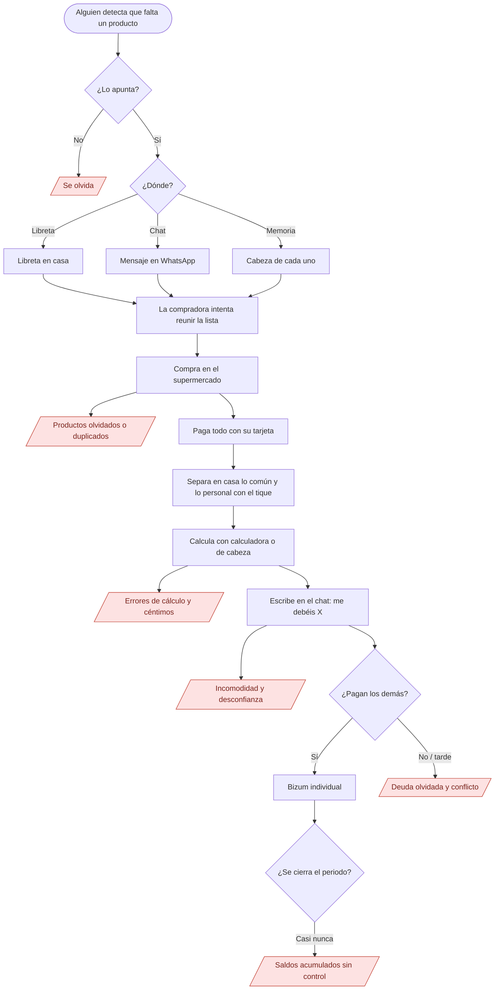
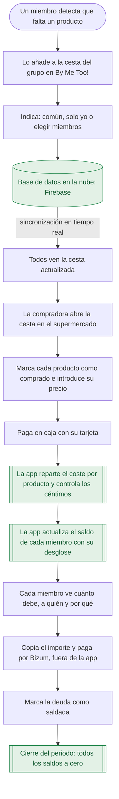
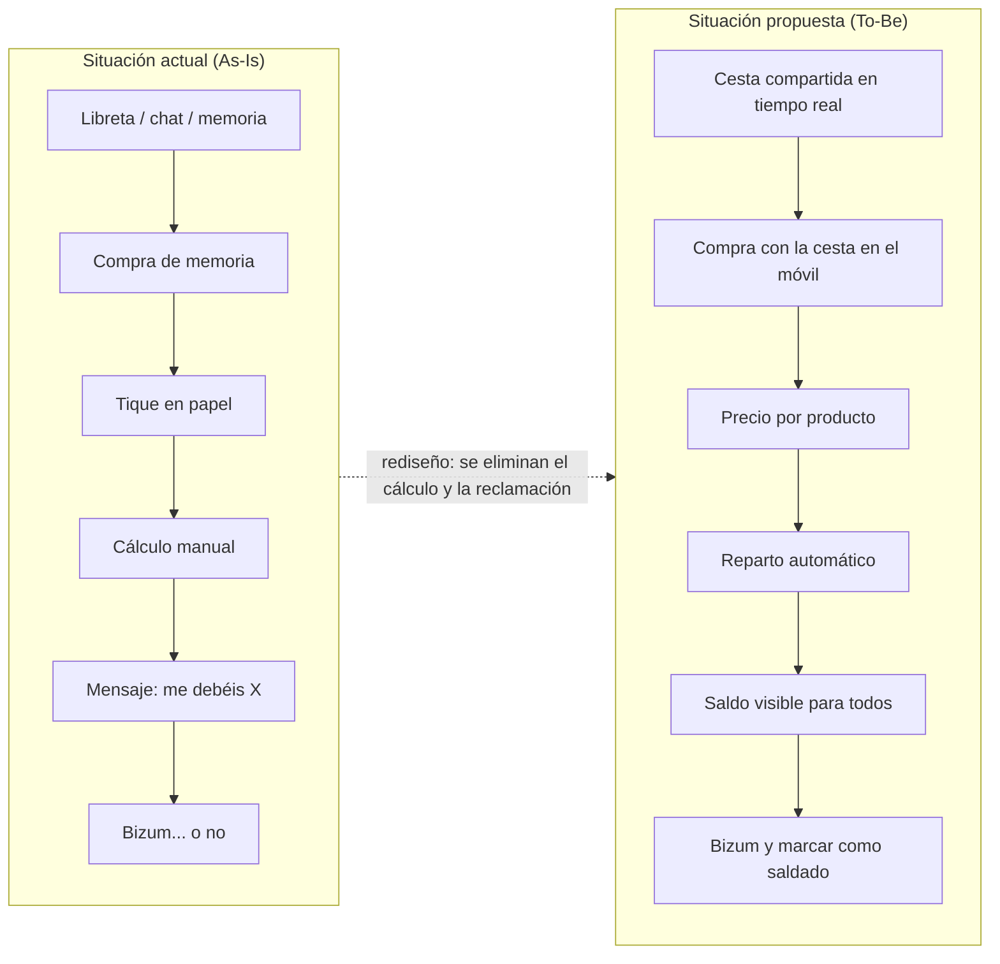

CENTRO FP SUPERIOR
CAMPUS CÁMARA COMERCIO SEVILLA

CICLO FORMATIVO DE GRADO SUPERIOR EN DESARROLLO DE APLICACIONES MULTIPLATAFORMA

TRABAJO:
“BY ME TOO!”
“¡CÓMPRAME!”

ALUMNOS:
SIARHEI LUKASHOU
PABLO AZOGUE
ELIAS PEREZ
ROBERTO HEREDIA

DOCENTE:
WILLMAN ACOSTA LUGO

ASIGNATURA:
PROYECTO INTERMODULAR

DECLARACIÓN DE ORIGINALIDAD

Los integrantes del equipo, estudiantes del Ciclo Formativo de Grado Superior en Desarrollo de Aplicaciones Multiplataforma del Centro FP Superior de la Cámara de Comercio de Sevilla, en relación con el Trabajo Proyecto Intermodular titulado «Pasado, presente y futuro», presentado para su defensa y evaluación durante el curso académico 2026/2027,

DECLARAMOS

que el presente trabajo es original y ha sido elaborado por los integrantes del equipo como parte de las actividades académicas correspondientes al citado ciclo formativo.

Asimismo, declaramos que todas las fuentes de información, referencias bibliográficas, recursos y materiales de terceros utilizados para la elaboración del presente trabajo han sido debidamente identificados y citados conforme a las normas académicas correspondientes, respetando en todo momento los principios de autoría, propiedad intelectual y honestidad académica.

Por tanto, asumimos la responsabilidad sobre la originalidad y autoría del contenido presentado, así como sobre la correcta identificación y citación de las fuentes empleadas.

Y para que así conste, firmamos la presente declaración a los efectos oportunos.

Sevilla, ____ de ______________ de 2027.

Firmas de los integrantes del equipo:

Nombre y apellidos: ______________________________
Firma: _________________________________________

Nombre y apellidos: ______________________________
Firma: _________________________________________

Nombre y apellidos: ______________________________
Firma: _________________________________________

Nombre y apellidos: ______________________________
Firma: _________________________________________

## RESUMEN EJECUTIVO

La esencia de este proyecto consiste en desarrollar una aplicación multiplataforma destinada a simplificar la gestión y el reparto de los gastos relacionados con las compras conjuntas entre personas que conviven en una misma casa o piso, que se reúnen para un evento, por ejemplo: 
entre compañeros de piso
personas que comparten el pago del alquiler 
un grupo de personas que se reúnen para celebrar el cumpleaños de un amigo.

El problema que pretende resolver este proyecto está relacionado con la dificultad de llevar un control preciso de los gastos realizados por los distintos miembros del grupo. En una misma compra, pueden adquirirse productos destinados a todos los compañeros del piso, así como productos destinados a una persona concreta. Esto puede dar lugar a confusiones y a la necesidad de calcular manualmente la cantidad que debe pagar cada participante. Además, pueden surgir ciertas molestias cuando una persona tiene que dirigirse directamente a otra para pedirle que le devuelva la cantidad correspondiente.

Nuestro equipo propone resolver este problema con la aplicación que os presentamos. Aplicación permitirá registrar las compras realizadas, identificar los artículos adquiridos y determinar a qué miembros del grupo corresponde cada gasto. A partir de esta información, el sistema podrá calcular automáticamente la cantidad que debe pagar cada miembro, mostrando de forma clara quién le debe dinero a quién y por qué. De este modo, el objetivo del proyecto es crear un sistema que simplifique la gestión de los gastos compartidos y permita reducir la necesidad de realizar cálculos manuales y de tener que pedir personalmente que te devuelvan 2 euros por una «Coca-Cola» que se compró hace un mes.

En la fase inicial del proyecto se llevó a cabo un estudio sobre las necesidades de los usuarios potenciales y las características que debía tener la aplicación. Para ello, se utilizó una metodología de investigación mediante encuesta, basada en la elaboración y distribución de cuestionarios, así como en el análisis posterior de las respuestas obtenidas. Los resultados de este estudio se utilizarán como base para definir las funcionalidades de la aplicación y establecer las características principales del sistema.

Para la organización del proyecto se combinarán distintos enfoques de trabajo. Se prevé utilizar el modelo en cascada (Waterfall) como metodología de desarrollo, mientras que para el seguimiento y el control de las actividades del equipo se aplicará la metodología «Scrum». El proyecto lo desarrollará un equipo formado por cuatro miembros, entre los que se repartirán las tareas y responsabilidades necesarias para llevar a cabo las distintas fases del desarrollo.

## PALABRAS CLAVE

## ÍNDICE GENERAL

DECLARACIÓN DE ORIGINALIDAD	2

RESUMEN EJECUTIVO	4

PALABRAS CLAVE	6

ÍNDICE DE FIGURAS	9

ÍNDICE DE TABLAS	10

LISTADO DE ACRÓNIMOS Y ABREVIATURAS	12
1. INTRODUCCIÓN	13

1.1. Contexto del proyecto	13

   1.1.1. Nivel Español: convivencia y 
recursos	13

   1.1.2. Nivel social: el auge de los pisos compartidos en España	13

   1.1.3. Nivel doméstico: la compra como gasto frecuente	13

1.1.4. Nivel tecnológico y sectorial: el nicho de mercado	13

1.1.5. La empresa tipo del proyecto: estructura y funciones	14

1.2 Problema o necesidad detectada	15

1.2.1 Contextualización del problema	15

1.2.2 De la necesidad general al problema concreto	16

1.2.3. La necesidad de gestionar los gastos	16

1.2.4. Usuarios afectados	17

1.2.5. Situación actual	17

1.2.6. Necesidad detectada	18

1.3. Propuesta de solución	18

1.3.1. Metodología utilizada para el estudio del problema	19

1.4.1. Objetivo general	20

1.4.2. Objetivos específicos	20

1.5. Alcance del proyecto	25

1.6. Limitaciones y exclusiones	26

1.6.1. Exclusiones (fuera del alcance de la versión 1.0)	26

1.6.2 Ayudas futuras	26

1.7. Estructura de la memoria	27

2. ANÁLISIS DEL CONTEXTO Y VIABILIDAD	28

2.1. Sector profesional y perfil de usuarios	28

2.1.1 Caracterización del sector	28

2.1.2 Segmentación de perfiles de usuario	33

2.1.3. Implicaciones para el diseño de la interfaz	37

2.2. Análisis de la necesidad	40

2.2.1. Diagnóstico de la situación de partida	42

2.2.2. Problemas y consecuencias identificadas	49

2.2.3. Propuesta de valor y situación deseada	53

2.2.4 Conclusión	65

2.3. Estudio de soluciones existentes	65

2.3.1. Identificación de software competidor	65

2.3.2. Análisis comparativo	68

2.3.3. Justificación de la propuesta y ventajas competitivas	70

2.3.4. Limitaciones y aspectos que deben validarse	71

2.3.5. Conclusión	72

2.4. Partes interesadas (Stakeholders)	72

2.4.1. Identificación de las partes interesadas	73
Partes interesadas externas	73

2.4.2. Análisis de poder e interés	73
Matriz de interesados (Poder vs. Interés)	74

2.4.3 Conclusión	75

2.5. Estudio de viabilidad técnica	75

2.5.1. Arquitectura y Pila Tecnológica (Tech Stack)	75

2.5.2. Requisitos de Hardware y Software	76

2.5.3. Control del Alcance y MoSCoW	77

2.5.4. Matriz de Riesgos y Curva de Aprendizaje	78

2.5.5. Ficha Técnica del Stack y Entorno de Ejecución	79

2.5.6. Conclusión sobre la Viabilidad Técnica	80

2.6. Estudio de viabilidad económica	80

2.6.1. Estudio de Mercado y Competencia	80

2.6.2. Estudio de Costes (Directos e Indirectos)	81

2.6.3. Presupuesto Total y Contraste de Valor	82

2.6.4. Modelo de Monetización y Rentabilidad	82

2.6.5. Financiación Pública y Ayudas al Emprendimiento	83

2.7. Estudio de viabilidad legal y normativa	83

2.7.1. Obligaciones Legales y Fiscales	83

2.7.2. Privacidad y Seguridad en el Software (RGPD / LOPDGDD)	84

2.7.3. Propiedad Intelectual y Licencias	84

2.7.4 Accesibilidad Universal (UNE-EN 301 549 y WCAG 2.1)	84

2.7.5. Prevención de Riesgos Laborales (PRL)	85

2.8. Análisis de riesgos inicial	85

2.8.1 Identificación de Riesgos	86

2.8.2 Evaluación de Riesgos	86

2.8.3 Plan de Mitigación	88

Referencias	93

ÍNDICE DE FIGURAS

Figura 1. Organigrama de la empresa tipo.	15

Figura 2. Flujo actual (As-Is)	49

Figura 3. Flujo propuesto (To-Be)	57

Figura 4. Comparación conceptual de los dos flujos	58

ÍNDICE DE TABLAS

Tabla 1. Soluciones existentes en el mercado y sus limitaciones	14

Tabla 2. Tabla de roles en SCRUM	15

Tabla 3. Objetivos específicos: fase de planificación.	21

Tabla 4. Objetivos específicos: fase de desarrollo.	22

Tabla 5. Objetivos específicos: fase de pruebas.	23

Tabla 6. Objetivos específicos: fase de distribución.	23

Tabla 7. KPI de producto.	24

Tabla 8. KPI de proyecto.	24

Tabla 9. KPI de distribución (prueba piloto).	25

Tabla 10. Objetivos y funciones	25

Tabla 11. Limitaciones	26

Tabla 12. Estructura de memoria	28

Tabla 17. Nivel país: digitalización de la población	29

Tabla 18. Nivel sector: pagos y organización doméstica digital.	31

Tabla 19. Nivel micro: la actividad concreta (la compra compartida)	31

Tabla 20. Resumen del sector y sus características organizativas	32

Tabla 21. Necesidades tecnológicas del sector	33

Tabla 22. Propuesta de plan gratuito y plan premium	34

Tabla 23. Ficha 1 — User Persona principal + Buyer Persona	35

Tabla 24. Ficha 2 — Usuario participante	36

Tabla 25. Ficha 3 — User Persona ocasional + Buyer Persona	37

Tabla 26. Implicaciones para el diseño de la interfaz. Plataforma	38

Tabla 26. Implicaciones para el diseño de la interfaz. Distribución	38

Tabla 27. Implicaciones para el diseño de la interfaz. Controles	39

Tabla 28. Implicaciones para el diseño de la interfaz. Atajos	40

Tabla 29. Marco teórico de referencia	42

Tabla 29. Estudio sobre cómo se habla del dinero de población española	43

Tabla 30. Estudio sobre sobre la organización de la compra	44

Tabla 31. Recreación proceso de compra compartida	46

Tabla 32. Recreación reparto de pagos	46

Tabla 33. Problemas comunes en la compra	52

Tabla 34. Consecuencias de problemas	52

Tabla 35. Trabajos que usuarios quieren	53

Tabla 35. Frustraciones y aliviadores	54

Tabla 36.Situaciones deseadas	55

Tabla 37.Indicadores de mejoras	59

Tabla 38.Necesidades funcionales justificadas	62

Tabla 39.Necesidades operacionales justificadas	64

Tabla 40. Trazabilidad de problemas a necesidades	65

Tabla 41. Comparativa competidores	69

Tabla 42. Matriz de interesados (Poder vs. Interés)	75

Tabla 43. Alcance exacto del Producto Mínimo Viable	78

Tabla 44. Matriz de Riesgos Técnicos y Mitigación	79

Tabla 45. Ficha Técnica del Stack y Entorno de Ejecución	80

Tabla 46. Presupuesto Total y Contraste de Valor	82

Tabla 47. Matriz Integrada de Análisis y Plan de Gestión de Riesgos	92

LISTADO DE ACRÓNIMOS Y ABREVIATURAS

# 1. INTRODUCCIÓN

## 1.1. Contexto del proyecto

### 1.1.1. Nivel Español: convivencia y recursos
Las Personas somos seres sociales por naturaleza viven en familia, entré amigos, una relación o en un apartamento.Si bien en las familias suele ser los padres quien pagan la mayoría de cosas , al vivir con por ejemplo compañeros de piso, significa buscar un equilibrio que sea bueno para todos y cuando se trata de ir al supermercado o pagar las facturas esto puede resultar en muchos problemas.

### 1.1.2. Nivel social: el auge de los pisos compartidos en España
Vivir fuera del núcleo familiar es una necesidad económica estructural:
Emancipación tardía: Supera los 30,2 años y solo el 14,5 % está emancipado (Consejo de la Juventud, 2025). Un 48 % de 25 a 34 años vive con sus padres (frente al 30 % en la UE).
Precio y oferta: El precio medio de una habitación es de 425 €/mes (+19 % en oferta en 2025, idealista).
Perfil: El 44 % tiene de 18 a 24 años y el 31,1 % supera los 35 (se comparte por obligación ante alquileres altos y precariedad).

### 1.1.3. Nivel doméstico: la compra como gasto frecuente
La compra es el gasto más recurrente y mezclado del hogar. Según nuestra encuesta (N = 75, docs/AnálisisDeMercado.md):
Frecuencia: El 66,7 % compra semanalmente y el 90 % cada 2–7 días (97 % de forma presencial).
Listas y despistes: El 71 % hace lista (48,5 % en libreta compartida, 24,2 % en chat), pero el 82,7 % olvida productos por no llevarla completa. El 21,3 % no usa ninguna herramienta.
Preferencias: Mercadona encabeza con un 92 %. El 80 % tiene entre 19 y 40 años (70 % estudiantes o recién titulados).

### 1.1.4. Nivel tecnológico y sectorial: el nicho de mercado
Aunque el smartphone organiza la vida diaria, la gestión doméstica sigue haciéndose en libretas, chats o de cabeza. En este escenario, By Me Too! se posiciona en la intersección entre listas de la compra y finanzas personales, resolviendo los huecos del mercado:

| Tipo de empresa | Ejemplos | Qué ofrecen | Qué no resuelve para nuestro público |
| --- | --- | --- | --- |
| Reparto de gastos | Splitwise, Tricount | App de gastos y deudas | Reparten por gasto total; el desglose por producto es de pago o manual. No gestionan listas. |
| Listas de compra | Bring! , Listonic | Listas compartidas en tiempo real (Bring! >21M de usuarios) | No reparten gastos entre los miembros. |
| Grandes tecnológicas | Google Keep, Apple, WhatsApp | Notas, listas y chat genéricos | Herramientas genéricas (el 24,2 % usa chats). |
| Distribución minorista | Mercadona, Dia | Compra online, cupones y fidelización | Enfocadas en su tienda y un solo comprador; sin grupo ni reparto. |

Tabla 1. Soluciones existentes en el mercado y sus limitaciones

Nuestra solución: Ninguna herramienta une lista compartida + reparto por producto adaptada a un grupo de iguales. El proyecto consiste en el desarrollo de una aplicación móvil para administrar compras compartidas entre compañeros de piso, estructurada en dos bloques:
Administración integral de perfiles y grupos de convivencia .
Registro detallado de tiques y liquidación automática de cuentas entre los miembros.

### 1.1.5. La empresa tipo del proyecto: estructura y funciones
By Me Too! adopta la estructura de una startup de software con metodología Scrum (roles rotativos entre el equipo):

Scrum Master
▼
Diseño UX/UI (Figma, Base44) | Front-end (Interfaz app) | Back-end (Firebase) | QA (Smoke tests) | Marketing y comunidad (Redes sociales)
Administración, fiscalidad y laboral: gestoría externa

Figura 1. Organigrama de la empresa tipo.

| rol | Funciones principales | Evidencia en el proyecto |
| --- | --- | --- |
| Scrum Master | Facilitar ceremonias y eliminar bloqueos | 8 sprints planificados en el Project |
| Diseño UX/UI | Investigación de usuario y prototipado | Wireframe, Figma y Base44 |
| Desarrollo front-end | Construcción de la interfaz | LoginWindow y MainWindow |
| Desarrollo back-end | Lógica de reparto y persistencia de datos | Esqueleto MVC, capa de datos en Firebase |
| QA | Pruebas y control de calidad | Documento de smoke test |
| Marketing y comunidad | Difusión en redes sociales | Estrategia de lanzamiento |
| Administración (externa) | Obligaciones fiscales y laborales | Gestoría externa |

Tabla 2. Tabla de roles en SCRUM

## 1.2 Problema o necesidad detectada

### 1.2.1 Contextualización del problema
En la actualidad vivimos en una sociedad en la que las personas realizan continuamente actividades que requieren organización, comunicación y colaboración con otras personas. Estas necesidades están presentes en diferentes ámbitos de nuestra vida cotidiana, desde la organización familiar hasta la convivencia con otras personas o la planificación de actividades y eventos.
Una de estas actividades es la realización de compras, una tarea habitual que, aunque puede parecer sencilla cuando la realiza una única persona, puede adquirir una mayor complejidad cuando intervienen varias personas.
Las necesidades de cada individuo pueden ser diferentes y, en determinadas situaciones, varias personas necesitan ponerse de acuerdo para decidir qué productos comprar, quién los necesita y cómo se van a repartir los gastos.
Esta situación es especialmente frecuente en familias, viviendas compartidas o grupos de personas que organizan actividades conjuntamente.

### 1.2.2 De la necesidad general al problema concreto
Cuando varias personas participan en una misma compra, aparece la necesidad de compartir y organizar la información relacionada con ella.
Tradicionalmente, esta comunicación puede realizarse mediante conversaciones presenciales, notas, listas de papel o aplicaciones de mensajería. Sin embargo, estos medios no están específicamente diseñados para gestionar una compra compartida.
Por ejemplo, en una conversación de mensajería pueden enviarse diferentes mensajes indicando productos que hay que comprar, pero posteriormente puede resultar difícil determinar cuáles se han añadido, cuáles se han eliminado o cuáles siguen pendientes.
A partir de esta situación surge una primera necesidad concreta:
Disponer de una herramienta que permita gestionar una cesta de compra de forma compartida y organizada.
Sin embargo, al analizar con mayor profundidad este tipo de situaciones, se observa que el problema no termina cuando se consigue determinar qué productos hay que comprar.
Cuando varias personas participan en una compra, también puede ser necesario determinar cuánto debe pagar cada una de ellas.

### 1.2.3. La necesidad de gestionar los gastos
El reparto de los gastos puede ser sencillo cuando todos los participantes consumen exactamente los mismos productos. Sin embargo, esta situación no siempre se produce.
Por ejemplo, en un piso compartido pueden existir productos de uso común, como alimentos o productos de limpieza, pero también productos que únicamente consume uno de los compañeros.
De la misma forma, en un cumpleaños, una barbacoa o una fiesta pueden existir productos que sean consumidos únicamente por determinados participantes.
Por este motivo, dividir simplemente el importe total de la compra entre todas las personas no siempre representa un reparto justo.
Surge así una segunda necesidad:
Disponer de un sistema que permita distribuir los gastos de una compra entre los usuarios que participan en ella, pudiendo determinar qué personas deben asumir el coste de cada producto.

### 1.2.4. Usuarios afectados
Las necesidades detectadas pueden aparecer en diferentes grupos de personas.
Familias
En una familia, una persona puede ser la encargada de acudir al supermercado mientras otros miembros de la familia indican los productos que necesitan.
En esta situación sería útil disponer de una cesta compartida en la que cada miembro pueda añadir sus productos y consultar la información actualizada.
Compañeros de piso
En una vivienda compartida pueden existir tanto productos comunes como productos individuales.
Además de conocer qué productos deben comprarse, los usuarios pueden necesitar determinar qué personas deben pagar cada producto.
Grupos que organizan eventos
En cumpleaños, barbacoas, fiestas u otros eventos, varias personas pueden colaborar en la compra.
En estos casos resulta necesario organizar los productos y posteriormente repartir los gastos entre las personas participantes.

### 1.2.5. Situación actual
Actualmente, estas situaciones pueden gestionarse mediante diferentes medios, como conversaciones de mensajería, notas o listas de compra.
Aunque estos métodos permiten compartir información, pueden generar determinados problemas cuando aumenta el número de participantes o de productos.
Entre ellos podemos encontrar:
Productos olvidados.
Productos duplicados.
Información desactualizada.
Dificultad para saber quién ha añadido cada producto.
Problemas para determinar qué productos son comunes y cuáles son individuales.
Dificultad para calcular cuánto debe pagar cada persona.
Necesidad de utilizar diferentes medios para gestionar los productos y los gastos.
Por tanto, se identifica la oportunidad de centralizar la gestión de la compra y el reparto de sus gastos en una única herramienta.

### 1.2.6. Necesidad detectada
Después de analizar la situación desde una perspectiva general hasta llegar al problema concreto, se identifican dos necesidades principales:
a. Gestionar una compra de forma colaborativa.
Los usuarios necesitan poder crear una cesta, añadir productos, eliminarlos y consultar la información actualizada de la compra.
b. Gestionar el reparto de los gastos.
Los usuarios necesitan poder determinar cómo se distribuye el coste de la compra y, cuando sea necesario, repartir productos concretos únicamente entre las personas que los van a consumir.
Estas necesidades dan lugar a la propuesta de desarrollar una aplicación específica para este propósito.

## 1.3. Propuesta de solución
Para dar respuesta a las necesidades detectadas se propone desarrollar una aplicación denominada:
By Me Too!
La aplicación tendrá como finalidad facilitar la organización de compras compartidas, permitiendo centralizar en una única cesta tanto los productos que deben comprarse como la distribución de sus gastos.
De esta forma, la aplicación permitirá:
Crear diferentes cestas.
Eliminar cestas.
Añadir productos.
Modificar productos.
Eliminar productos.
Compartir una cesta entre diferentes usuarios.
Mantener la información actualizada.
Dividir el coste total de la compra.
Asignar productos a determinados usuarios.
Dividir el coste de cada producto entre las personas que lo consumen.
Así, una necesidad cotidiana y general de organización y colaboración entre personas se concreta en una solución tecnológica destinada a un problema específico: la gestión colaborativa de compras y el reparto de sus gastos.

### 1.3.1. Metodología utilizada para el estudio del problema
Para llegar a la identificación del problema se ha seguido un proceso de análisis que parte de situaciones generales de la vida cotidiana y se va concretando hasta determinar una necesidad que pueda ser resuelta mediante una aplicación.
En primer lugar, se realizó una observación de situaciones cotidianas en las que varias personas participan en la organización de una compra.
Posteriormente, se analizaron diferentes perfiles de usuarios, principalmente familias, compañeros de piso y grupos que organizan eventos, con el objetivo de identificar las dificultades que pueden aparecer en cada situación.
A continuación, se realizó una recogida de información mediante encuestas a usuarios potenciales, con el objetivo de comprobar si las necesidades detectadas durante la observación también estaban presentes en otras personas.
A partir de la información obtenida se realizó un análisis de necesidades, identificando dos problemas principales: la gestión colaborativa de los productos y el reparto de los gastos.
Finalmente, se transformaron estas necesidades en requisitos y funcionalidades concretas, dando lugar a la propuesta de desarrollo de By Me Too!.
Técnicas utilizadas
Observación: análisis de situaciones cotidianas relacionadas con las compras compartidas.
Encuesta: recogida de opiniones y necesidades de usuarios potenciales.
Análisis de necesidades: identificación de los problemas comunes entre los diferentes usuarios.
Definición de requisitos: transformación de las necesidades detectadas en funcionalidades concretas para la aplicación.

## 1.4. Objetivos del proyecto

### 1.4.1. Objetivo general
Desarrollar, entre el 21/09/2026 y el 22/02/2027, una aplicación multiplataforma que permita a los grupos de convivencia gestionar una lista de la compra compartida y repartir de forma automática, clara y justa el coste de cada producto entre las personas que lo consumen, eliminando los cálculos manuales y facilitando la liquidación de los saldos al final de cada periodo.

### 1.4.2. Objetivos específicos
Los objetivos específicos desglosan el objetivo general en logros concretos, observables y medibles, ordenados por fases. Cada uno se redacta como una acción, indica para qué se hace y cómo se consigue, y lleva un indicador que permite comprobar si se ha cumplido.
Fase 1. Planificación (Sprints 1–2). En esta fase se tienen en cuenta la validación con usuarios reales, la delimitación del MVP, los plazos del centro y los recursos del equipo.

| ID | Acción | Para qué | Cómo | Indicador |
| --- | --- | --- | --- | --- |
| OE-P1 | Validar la necesidad del producto | Orientar el MVP a lo que el usuario demanda | Encuesta en Google Forms al público objetivo | ≥ 50 respuestas. Conseguido: 75 |
| OE-P2 | Priorizar el problema principal y definir el MVP | Concentrar el esfuerzo en el valor diferencial | Matriz de priorización con datos de la encuesta y de la competencia | Problema y MVP documentados. Conseguido (1.2.6) |
| OE-P3 | Elaborar el Product Backlog | Disponer de un plan de trabajo trazable | Issues en GitHub Projects con etiquetas PD- y DI-, responsable y estimación | 100 % de las tareas con responsable y estimación |
| OE-P4 | Planificar los 8 sprints con fechas y entregables | Cumplir los hitos de evaluación | Calendario de sprints en el tablero | Calendario publicado. Conseguido (1.7) |
| OE-P5 | Analizar la viabilidad técnica, económica y legal | Confirmar que el proyecto es realizable y sostenible | Estudio de factibilidad: arquitectura, riesgos, presupuesto, normativa | Capítulo 2 entregado en el Sprint 2 |

Tabla 3. Objetivos específicos: fase de planificación.

Fase 2. Desarrollo (Sprints 3–6). En esta fase se tienen en cuenta la facilidad de uso en el supermercado, la concurrencia entre varios usuarios, la precisión del cálculo y la protección de los datos.

| ID | Acción | Para qué | Cómo | Indicador |
| --- | --- | --- | --- | --- |
| OE-D1 | Diseñar los prototipos de todas las pantallas | Validar la experiencia antes de programar | Wireframe, Figma y Base44 | Flujo completo prototipado. Conseguido |
| OE-D2 | Implementar el registro, el inicio de sesión y la gestión de grupos | Identificar a los miembros de cada grupo | Autenticación y modelo de usuario y grupo | Un usuario crea un grupo e invita a otro |
| OE-D3 | Implementar la lista compartida en tiempo real | Eliminar la lista dispersa y los olvidos | Sincronización con la base de datos en la nube | Los cambios se ven en otro dispositivo en ≤ 2 s |
| OE-D4 | Implementar el registro de compras | Registrar el comprador, el precio y los participantes | Formulario de compra vinculado a la lista | Compra de 5 productos registrada en ≤ 60 s |
| OE-D5 | Programar el algoritmo de reparto común, personal y parcial | Repartir el coste de forma justa | Lógica de negocio en la capa de modelo con control de céntimos y redondeos | 0 errores en los casos de prueba |
| OE-D6 | Implementar el balance y la liquidación por periodos | Saldar las cuentas sin deudas olvidadas | Cálculo de saldos semanal, quincenal, mensual o personalizado | Saldo correcto de cada miembro al cerrar el periodo |
| OE-D7 | Proteger los datos personales | Cumplir el RGPD y la LOPDGDD [8], [9] | Minimización de datos, reglas de acceso por grupo, política de privacidad | Reglas de acceso definidas y política redactada |
| OE-D8 | Mantener un código limpio y versionado | Facilitar el trabajo en equipo y el mantenimiento | Ramas por miembro, revisión mediante Pull Request, patrón MVC | 100 % de las integraciones en main mediante PR |

Tabla 4. Objetivos específicos: fase de desarrollo.

Fase 3. Pruebas (de forma continua, con foco en los Sprints 6–7). En esta fase se tienen en cuenta la estabilidad de cada build, los casos límite del reparto y la opinión de usuarios reales.

| ID | Acción | Para qué | Cómo | Indicador |
| --- | --- | --- | --- | --- |
| OE-T1 | Ejecutar un smoke test en cada build | Detectar fallos críticos antes de seguir probando | Checklist del documento de smoke test | 100 % de los puntos críticos superados |
| OE-T2 | Automatizar las pruebas unitarias del reparto | Garantizar cálculos correctos | JUnit con casos límite: un participante, céntimos indivisibles, productos sin precio | Cobertura ≥ 80 % del módulo de reparto |
| OE-T3 | Realizar pruebas de integración y de extremo a extremo | Validar el flujo completo | Lista, compra, reparto y balance con 4 usuarios | Flujo completo sin errores |
| OE-T4 | Evaluar la usabilidad | Comprobar que la aplicación es fácil de usar | Prueba con usuarios del público objetivo y cuestionario SUS | Puntuación SUS ≥ 70 |
| OE-T5 | Controlar la regresión | Evitar que una corrección rompa otra función | Registro de incidencias en la columna «To Fix» del tablero | 0 bugs críticos abiertos en la entrega |

Tabla 5. Objetivos específicos: fase de pruebas.

Fase 4. Distribución (Sprints 7–8). En esta fase se tienen en cuenta los requisitos de las tiendas, la documentación para el usuario y la captación de los primeros usuarios.

| ID | Acción | Para qué | Cómo | Indicador |
| --- | --- | --- | --- | --- |
| OE-X1 | Desplegar una versión estable para un grupo piloto | Validar el producto en uso real | Build firmada y entorno de producción separado del de pruebas | Versión 1.0 instalada por el grupo piloto |
| OE-X2 | Preparar la publicación en Google Play y App Store | Llegar a los dos sistemas que usa el público | Cuentas de desarrollador, ficha de la tienda y política de privacidad | Ficha y build listas para revisión |
| OE-X3 | Redactar los manuales de instalación, técnico y de usuario | Permitir que otra persona instale y use el sistema | Manuales con capturas de la versión final | Capítulo 9 entregado |
| OE-X4 | Lanzar una campaña inicial | Captar a los primeros usuarios | Redes sociales y boca a boca en entornos universitarios | KPI de distribución medidos |
| OE-X5 | Recoger el feedback y definir las líneas futuras | Planificar la evolución del producto | Encuesta al piloto y backlog de la versión 2 | Backlog de la versión 2 priorizado |

Tabla 6. Objetivos específicos: fase de distribución.

### 1.4.3. Indicadores clave de rendimiento (KPI)
Los valores objetivo son las metas que se fija el equipo y se revisarán en cada Sprint Review.

| KPI | Definición | Objetivo |
| --- | --- | --- |
| Precisión del reparto | Repartos cuya suma coincide al céntimo con el total del ticket | 100 % |
| Tiempo de registro | Tiempo medio en registrar una compra de 5 productos con su reparto | ≤ 60 s |
| Activación | Usuarios que, en su primera semana, se unen a un grupo y registran una compra | ≥ 60 % |
| Retención a 30 días | Grupos piloto que siguen registrando compras al cabo de 30 días | ≥ 40 % |
| Periodos liquidados | Periodos cerrados con todos los saldos a cero | ≥ 70 % |

Tabla 7. KPI de producto.

| KPI | Definición | Objetivo |
| --- | --- | --- |
| Cumplimiento del sprint | Tareas en Done respecto a las comprometidas | ≥ 80 % (Sprint 1: 17 de 20, el 85 %) |
| Entregas en plazo | Sprint Reviews entregadas en la fecha prevista | 100 % |
| Calidad de la build | Smoke tests superados respecto a los ejecutados | 100 % |
| Bugs críticos | Bugs críticos abiertos en cada entrega | 0 |
| Trazabilidad | Commits y PR vinculados a un issue | ≥ 90 % |

Tabla 8. KPI de proyecto.

| KPI | Definición | Objetivo |
| --- | --- | --- |
| Usuarios piloto | Usuarios activos durante la prueba piloto | ≥ 10 |
| Grupos activos | Grupos con al menos una compra semanal | ≥ 2 |
| Valoración | Nota media del feedback (escala de 1 a 5) | ≥ 4.5 |
| Conversión de la encuesta | Encuestados interesados que instalan la aplicación | ≥ 30 % |

Tabla 9. KPI de distribución (prueba piloto).

## 1.5. Alcance del proyecto
El proyecto aspira a convertirse en una herramienta de uso diario, siendo el objetivo llegar a:
Usuarios: grupos de 2 a 10 personas aproximadamente, de 18 a 50 años; foco en compañeros de piso de 19 a 35 años.
Plataformas: Android e iOS + Versión ejecutable de escritorio.
Ámbito geográfico inicial: España, con euros como moneda e idioma español.

| Objetivos | Funciones |
| --- | --- |
| Perfiles personales con la información relevante | Registro, login y perfil |
| Gestión de varios grupos por usuario | Crear, unirse, invitar, gestionar miembros |
| Lista / cesta compartida en tiempo real | Añadir, quitar y modificar productos; varias cestas |
| Registro de compras | Comprador, importe, concepto y participantes |
| Reparto común / personal / parcial | Algoritmo de reparto por producto |
| Balances y liquidación por periodos | Resumen semanal, quincenal, mensual o personalizado |

Tabla 10. Objetivos y funciones

## 1.6. Limitaciones y exclusiones

| Limitación | Descripción | Medida para mitigarla |
| --- | --- | --- |
| Tiempo | Desarrollo acotado del 21/09/2026 al 22/02/2027, compartido con otros módulos | Trabajar siguiendo la metodología SCRUM con Sprints de unas dos semanas |
| Aprendizaje simultáneo | Conocimientos y tecnologías nuevas aprendidas a la vez o a destiempo de la implementación | Afirmar y practicar los conceptos aprendidos tanto en clase como por nuestra propia cuenta de manera previa antes de aplicarlos |
| Falta de experiencia | Primer proyecto de esta escala para el equipo | Retrospectivas, revisión por PR y roles rotativos |
| Equipo reducido | Cuatro personas cubren todos los roles | Reparto claro de responsabilidades en el Project |
| Recursos económicos | Sin financiación: solo herramientas gratuitas | Aprovechar planes gratuitos; Usar los recursos ofrecidos |

Tabla 11. Limitaciones

### 1.6.1. Exclusiones (fuera del alcance de la versión 1.0)
Pagos dentro de la aplicación: descartados (PD-1.6). La app calcula y muestra los saldos; el pago se hace por fuera (efectivo, Bizum, transferencia). Evita además la regulación financiera de servicios de pago.
Escaneo OCR de tickets: Integración en versión futura.
Integración con catálogos o precios de supermercados: Integración en versión futura.
Multimoneda e internacionalización: solo euros y español en la versión 1.0.
Multiplataformas: prioridad para aplicaciones de móvil.

### 1.6.2 Ayudas futuras
Para la implementación de algunas de las exclusiones nombradas y a avanzar más en un futuro desarrollo existen vías para proyectos como este como:

Incubadoras de proyectos:
La fábrica de Sevilla
Andalucía Open Future
Tecnoincubadora Marie Curie de Sevila TechPark
Ofrecen servicios cómo Financiación pública y privada, contacto con otras empresas del sector, programas de innovación abierta, centros de investigación, oficina con herramientas y servicios necesarios y mentoria y asesoria.

Subvenciones enfocadas a este tipo de proyectos:
Next Generation EU por parte de la Unión Europea
Convocatorias por parte del Gobierno de España y Comunidades Autónomas

## 1.7. Estructura de la memoria
La memoria sigue la plantilla de índice propuesta para el Proyecto Intermodular. Cada capítulo mantiene la trazabilidad con los demás: cada requisito del Capítulo 4 tendrá un diseño en el 5, una implementación en el 6 y una prueba en el 7.

| Capítulo | Contenido |
| --- | --- |
| Preliminares | Portada, declaración de autoría, resumen ejecutivo, palabras clave, índices y acrónimos |
| 1. Introducción | Contexto, problema, solución, objetivos, alcance, limitaciones y estructura |
| 2. Análisis del contexto y viabilidad | Sector y perfil de usuarios, análisis de la necesidad, soluciones existentes (benchmarking), partes interesadas, viabilidad técnica, económica y legal, riesgos iniciales |
| 3. Planificación y gestión del proyecto | Metodología Scrum, organización y roles, plan de trabajo, cronograma, recursos, presupuesto, riesgos, herramientas y gestión de versiones |
| 4. Análisis de requisitos | Perfiles de usuario, requisitos funcionales y no funcionales verificables, reglas de negocio (algoritmo de reparto), historias de usuario, priorización y matriz de trazabilidad |
| 5. Diseño de la solución | Arquitectura y patrón MVC, componentes, modelo de datos, mapa de navegación, wireframes y diseño final, seguridad |
| 6. Desarrollo e implementación | Tecnologías, entorno, estructura del código, funcionalidades principales, persistencia, interfaz, dependencias, ramas y decisiones técnicas |
| 7. Pruebas y aseguramiento de la calidad | Estrategia, smoke tests, pruebas unitarias, funcionales, de usabilidad y de seguridad; resultados e incidencias |
| 8. Despliegue y puesta en producción | Infraestructura, instalación, despliegue, configuración, copias de seguridad, monitorización y mantenimiento |
| 9. Manuales de uso | Manual de instalación, técnico y de usuario; preguntas frecuentes |
| 10. Resultados y evaluación final | Producto desarrollado, cumplimiento de objetivos, requisitos y KPI, comparación entre lo planificado y lo real, dificultades |
| 11. Conclusiones y líneas futuras | Conclusiones, mejoras, escalabilidad y reflexión sobre el aprendizaje |
| Referencias y anexos | Referencias en formato IEEE; requisitos, diagramas, modelo de datos, pruebas, presupuesto, cronograma, licencias, repositorio |

Tabla 12. Estructura de memoria

Herramienta: GitHub Projects (Kanban: To Do → In progress → Ready → To Fix → In review → Done), con una vista por sprint.
Nomenclatura: PD- para Proyecto Intermodular y DI- para Desarrollo de Interfaces; cada tarea es un issue con responsable, estimación y sprint.
Código: rama por miembro (siarhei-branch, pablo-branch, roberto-branch, elias-branch) e integración en main mediante Pull Request.
Documentación: Markdown en el repositorio Proyecto-Intermodular-By-Me-Too, un archivo por apartado (PD-x.x).

# 2. ANÁLISIS DEL CONTEXTO Y VIABILIDAD

## 2.1. Sector profesional y perfil de usuarios
El análisis va de lo macro a lo micro: primero el país y la sociedad, después la digitalización y el sector, luego el tipo de organización que usará la aplicación, a continuación las personas concretas y, por último, las decisiones de interfaz que se derivan de todo ello.
Cada término técnico, sigla o anglicismo se explica la primera vez que aparece. Las cifras externas proceden de las fuentes del apartado Referencias (consultadas el 20/10/2026). Los datos marcados como [Encuesta] proceden de la encuesta propia del equipo (N = 75, es decir, 75 personas respondieron), recogida en el apartado 1.1.3 de la memoria.

### 2.1.1 Caracterización del sector

#### A. Nivel macro: contexto social y económico en España

Vivienda compartida. La dificultad de acceso a la vivienda hace que compartir piso sea una solución cada vez más habitual. Según el portal inmobiliario idealista, en 2025 la oferta de habitaciones en piso compartido creció un 19 % interanual (es decir, respecto al año anterior) y el precio medio de una habitación alcanzó los 425 €/mes (575 € en Madrid y 600 € en Barcelona) [18].

Consecuencia para el proyecto: cada vez más personas sin vínculo familiar conviven y comparten gastos cotidianos, que es exactamente el problema que resuelve By Me Too!.

#### B. Nivel país: digitalización de la población

| Indicador | Dato | Qué significa para la app | Fuente |
| --- | --- | --- | --- |
| Uso de Internet (16–74 años) | 96,3 % en los últimos 3 meses; 92,5 % a diario (2025) | Casi toda la población potencial está conectada a diario | [20] |
| Hogares sólo con móvil | 50,3 % de los hogares no tiene teléfono fijo, solo móvil | El móvil es el dispositivo central del hogar | [20] |
| Compras por Internet | 59,6 % compró en línea en los últimos 3 meses | Los usuarios conocen los flujos de compra digitales | [20] |
| Banca por Internet | 74,7 % la usa | Manejar dinero desde el móvil es un hábito normal | [20] |
| Competencias digitales | 66,5 % tiene habilidades digitales básicas o superiores (INE 2025); según la Comisión Europea, España (66,2 %) supera la media de la UE (55,6 %) (2024) | El usuario medio entiende interfaces móviles estándar, pero no todos son expertos | [20], [4] |

Tabla 17. Nivel país: digitalización de la población

INE: Instituto Nacional de Estadística, organismo oficial que elabora las estadísticas de España. UE: Unión Europea.

#### C. Nivel sector: pagos y organización doméstica digital

Ámbito de actividad. By Me Too! se sitúa entre dos sectores digitales:
1. Finanzas personales y pagos P2P. P2P (del inglés peer-to-peer, "de persona a persona") son los pagos que se hacen directamente entre particulares, sin una tienda de por medio; por ejemplo, devolverle a un compañero de piso lo que adelantó.

2. Organización doméstica y compra de alimentación: listas de la compra compartidas.

Tendencia principal: el pago P2P instantáneo ya está normalizado. Bizum (sistema español de pago instantáneo entre particulares desde la app del banco) tuvo en 2025 30,6 millones de usuarios, 1.237 millones de operaciones (+13,2 %) y un volumen de 67.751 millones de euros [3]. Pagar ya no es el problema; el problema es saber cuánto debe cada uno. Por eso el proyecto no integra pagos dentro de la app (Memoria 1.6.1) y se centra en el cálculo.

Plataformas móviles. En España, el 73,19 % de los móviles usa Android (sistema de Google) y el 26,8 % iOS (sistema de Apple, iPhone) (septiembre 2026) [5]. Un mismo grupo de convivencia suele mezclar ambos, así que la app debe funcionar en los dos.

Competencia.

| Tipo de solución | Ejemplos | Qué ofrecen | Qué les falta para nuestro público |
| --- | --- | --- | --- |
| Reparto de gastos | Splitwise, Tricount | Registrar quién pagó y quién debe a quién. Tricount declara más de 20 millones de usuarios [23]; Splitwise se dirige a "amigos y compañeros de piso" [24] | Reparten por gasto total; no gestionan la lista de la compra |
| Listas de la compra | Bring!, Listonic, Google Keep | Listas compartidas en tiempo real | No reparten gastos |
| Mensajería | WhatsApp | Chat de grupo | No está pensada para listas ni cuentas ([Encuesta] el 24,2 % organiza la compra por chat) |

Tabla 18. Nivel sector: pagos y organización doméstica digital.

#### D. Nivel organización: quién usa la aplicación

La app no se dirige a empresas, sino a particulares:

- B2B (business-to-business, "de empresa a empresa"): productos que una empresa vende a otras empresas (por ejemplo, un programa de contabilidad para despachos).

- B2C (business-to-consumer, "de empresa a consumidor"): productos dirigidos directamente al usuario final particular.

By Me Too! es un producto B2C. La "organización" que la utiliza no es una empresa, sino un grupo de convivencia informal: un piso compartido, una familia o el grupo de un evento.

#### E. Nivel micro: la actividad concreta (la compra compartida)

| Característica | Dato | Fuente |
| --- | --- | --- |
| Tamaño del grupo | 2-10 personas | Memoria 1.5 |
| Estructura | Sin jerarquía: todos los miembros son iguales; quien crea el grupo actúa como administrador | Memoria 1.5 |
| Frecuencia | 66,7 % compra cada semana; 90 % cada 2–7 días | [Encuesta] |
| Canal | 97 % compra en tienda física (presencial) | [Encuesta] |
| Herramientas actuales | 48,5 % libreta compartida, 24,2 % chat, 21,3 % ninguna | [Encuesta] |
| Problema principal | 82,7 % olvida productos por no llevar la lista completa | [Encuesta] |

Tabla 19. Nivel micro: la actividad concreta (la compra compartida)

#### Tabla 1. Resumen del sector y sus características organizativas (de macro a micro)

| Nivel | Característica clave | Dato principal | Fuente |
| --- | --- | --- | --- |
| Social | El piso compartido crece | Oferta de habitaciones +19 %; 425 €/mes | [18] |
| País | Población muy conectada, móvil como centro | 92,5 % usa Internet a diario; 50,3 % hogares solo móvil | [20] |
| País | Competencias digitales medias-altas | 66,5 % básicas o superiores | [20] |
| Sector | Pago P2P normalizado | Bizum: 30,6 M usuarios | [19] |
| Sector | Mercado Android + iOS | 73 % / 27 % | [5] |
| Sector | Competidores no unen lista + reparto | Splitwise, Tricount, Bring! | [23], [24] |
| Organización | B2C: grupo informal sin jerarquía | 2–10 miembros | Memoria 1.5 |
| Actividad | Compra presencial, semanal, con olvidos | 66,7 % semanal; 82,7 % olvida productos | [Encuesta] |

Tabla 20. Resumen del sector y sus características organizativas 

#### Necesidades tecnológicas del sector

| Necesidad | Requisito tecnológico derivado |
| --- | --- |
| Varias personas editan la misma lista a la vez | Sincronización en tiempo real: un cambio en un móvil aparece en los demás en segundos. Se usará Firebase (servicio de Google que ofrece base de datos en la nube y autenticación de usuarios) |
| Registrar la compra rápido en el supermercado | Interfaz móvil usable con una mano. KPI (Key Performance Indicator, "indicador clave de rendimiento", una métrica medible del éxito): registrar 5 productos en ≤ 60 s |
| Reparto justo por producto | Algoritmo de reparto común / personal / parcial con control de céntimos |
| Confianza en los saldos | Historial visible de quién pagó qué y por qué |
| Pago fuera de la app (Bizum, efectivo) | Mostrar importes claros y fáciles de copiar; sin pasarela de pago |
| Datos personales de otras personas | Cumplir el RGPD (Reglamento General de Protección de Datos de la UE) y la LOPDGDD (Ley Orgánica española de Protección de Datos Personales y garantía de los derechos digitales) |
| Grupos que mezclan Android e iOS | Desarrollo multiplataforma (un solo código para varios sistemas) con Flutter (herramienta de Google para crear apps para Android, iOS y escritorio a la vez) |

Tabla 21. Necesidades tecnológicas del sector

### 2.1.2 Segmentación de perfiles de usuario 
Segmentar es dividir a los usuarios en grupos con necesidades parecidas. Cada grupo se describe con una ficha de persona:

- User Persona ("persona de usuario"): personaje ficticio, pero basado en datos reales, que representa a quien usa la app: qué hace con ella, dónde, cuándo y qué le cuesta. Sirve para diseñar pantallas, flujos y controles.

- Buyer Persona ("persona compradora"): personaje que representa a quien decide pagar por el producto: qué le convence, cuánto está dispuesto a pagar y qué le frena. Sirve para el modelo de negocio y el marketing. Ambas coinciden solo cuando quien usa y quien paga es la misma persona. En un software de empresa (B2B) suelen ser distintas: lo compra un directivo y lo usa un empleado.

Modelo de negocio de By Me Too!: freemium. Freemium (de free, "gratis", y premium) es un modelo en el que la app es gratuita para todos y existe una suscripción opcional de pago con ventajas extra. Por tanto:

- Todos los perfiles son User Persona, porque todos usan la app, paguen o no.

- Solo una parte es además Buyer Persona: quien decide pagar la suscripción premium.

Nota: la Memoria (1.6.1) excluye los pagos entre miembros dentro de la app (las deudas se saldan por Bizum, efectivo o transferencia). La suscripción premium es otra cosa: es el pago del usuario a By Me Too!.

#### Plan gratuito y plan premium (propuesta del equipo):

| | Gratuito | Premium |
| --- | --- | --- |
| Grupos | Número limitado (propuesta: hasta 2 grupos activos) | Más grupos (propuesta: ilimitados) |
| Anuncios | Sí | Sin anuncios |
| Escaneo de tiques por OCR (Optical Character Recognition, "reconocimiento óptico de caracteres": la app lee el texto de una foto del tique) | No | Sí (versión futura, Memoria 1.6.1) |
| Lista compartida, reparto y saldos | Sí | Sí |
| Precio propuesto | 0 € | 1,99 €/mes o 14,99 €/año (≈ 37 % de ahorro con el pago anual) |

Tabla 22. Propuesta de plan gratuito y plan premium 

Justificación del precio. Es una propuesta propia del equipo, no un dato de mercado. Se basa en que: (1) el público principal son estudiantes y jóvenes recién titulados ([Encuesta] 70 %), con poco presupuesto; (2) el competidor directo Splitwise también usa un modelo freemium con suscripción mensual o anual que elimina anuncios y añade escaneo de tiques, y limita el plan gratuito a 4 gastos al día [14], [15]; (3) Tricount es totalmente gratuito y sin anuncios [6], así que el premium debe ser barato para que el plan gratuito con anuncios no haga huir al usuario hacia la competencia. El precio exacto de Splitwise Pro no aparece en sus páginas públicas, por lo que no se usa como cifra de comparación. El precio se validará con el grupo piloto (Memoria, OE-X5).

Las fichas son arquetipos (modelos representativos de un grupo, no personas reales); los nombres y detalles personales son inventados. Se basan en la encuesta (80 % entre 19 y 40 años; 70 % estudiantes o recién titulados) y en los grupos detectados en la memoria (1.2.4): compañeros de piso, familias y grupos de eventos.

#### Ficha 1 — "La organizadora del piso" (User Persona principal + Buyer Persona)

| Campo | Descripción |
| --- | --- |
| Nombre / edad | Lucía, 22 años |
| Rol laboral | Estudiante universitaria; comparte piso con 3 personas. Hace la compra semanal y adelanta el dinero. Rol en la app: administradora del grupo y compradora habitual. |
| Competencias digitales previas | Altas. Usa a diario WhatsApp, Instagram, Bizum y banca móvil; ha probado Splitwise o Google Keep. Maneja con soltura gestos táctiles, notificaciones y enlaces compartidos. |
| Entorno de uso habitual | Móvil Android. En el supermercado: de pie, empujando el carro, con una mano ocupada y prisa. En casa: en el sofá, revisando el tique. Sesiones cortas, 2–3 veces por semana. |
| Objetivos principales | 1) Llevar la lista completa y no olvidar productos. 2) Registrar la compra en menos de un minuto. 3) Marcar qué es común y qué es personal. 4) Recuperar su dinero sin tener que reclamarlo en persona. |
| Frustraciones | Mensajes dispersos en el chat, productos duplicados, cálculos con la calculadora, incomodidad al pedir dinero. |
| Frase | "Yo pago todo y luego nunca sé cuánto me debe cada uno." |
| Como Buyer Persona | Compradora probable del premium. Es quien descubre la app y convence al grupo. Motivos para pagar: quitar los anuncios, que abre a diario, y, en el futuro, el OCR para no teclear tiques largos. Freno: presupuesto de estudiante; solo paga si el precio es bajo (pago anual) y la ventaja se nota desde el primer día. |

Tabla 23. Ficha 1 — User Persona principal + Buyer Persona

#### Ficha 2 — "El compañero que paga" (usuario participante)

| Campo | Descripción |
| --- | --- |
| Nombre / edad | Andrés, 29 años |
| Rol laboral | Trabajador a jornada completa en piso compartido. Casi nunca hace la compra. Rol en la app: participante; añade productos y consulta su saldo. |
| Competencias digitales previas | Medias-altas. Usa banca móvil y Bizum, pero no quiere aprender herramientas nuevas: espera que la app se entienda sola. |
| Entorno de uso habitual | iPhone, en ratos muertos (transporte, descanso del trabajo). Uso breve y esporádico: abrir, ver cuánto debe, hacer un Bizum, cerrar. A veces desde el ordenador del trabajo (versión de escritorio). |
| Objetivos principales | 1) Añadir rápido a la lista lo que necesita. 2) Saber de un vistazo cuánto debe y a quién. 3) Entender por qué debe esa cantidad. 4) Saldar la deuda sin discusiones. |
| Frustraciones | Pagar productos que no consume, recordatorios insistentes, pantallas cargadas de información. |
| Frase | "Dime cuánto es y te hago un Bizum." |
| Como Buyer Persona | No es comprador. Abre la app poco y no necesita más grupos, así que no pagaría. Es importante que el plan gratuito le resulte cómodo: si los anuncios le molestan, deja de usarla y el grupo entero se resiente. |

Tabla 24. Ficha 2 — Usuario participante

#### Ficha 3 — "La organizadora del evento" (User Persona ocasional + Buyer Persona)

| Campo | Descripción |
| --- | --- |
| Nombre / edad | Marta, 38 años |
| Rol laboral | Profesional con familia; organiza cumpleaños, barbacoas o viajes con amigos y familiares. Rol en la app: crea un grupo temporal y compra de forma puntual. |
| Competencias digitales previas | Medias. Usa WhatsApp, banca online y compras por Internet; menos habituada a gestos avanzados o a apps de finanzas. |
| Entorno de uso habitual | Móvil (Android o iOS) en varias tiendas distintas; después del evento, en casa con varios tiques. Uso intenso durante unos días y luego nada. |
| Objetivos principales | 1) Crear el grupo e invitar a todos en segundos (enlace por WhatsApp). 2) Repartir ciertos productos solo entre quienes los consumen (por ejemplo, bebidas alcohólicas o menú infantil). 3) Cerrar el evento con todos los saldos a cero. |
| Frustraciones | Que los invitados tengan que registrarse con muchos pasos; perder la cuenta de varios tiques; repartos "a partes iguales" que no son justos. |
| Frase | "Quiero cerrar las cuentas del cumpleaños el mismo día." |
| Como Buyer Persona | Compradora posible. Tiene más poder adquisitivo y crea muchos grupos temporales (cada evento es un grupo), por lo que choca antes con el límite de grupos del plan gratuito. Motivo para pagar: más grupos y, en el futuro, el OCR para los varios tiques de un evento. Freno: uso intermitente; prefiere un pago mensual que pueda cancelar cuando no organiza nada. |

Tabla 25. Ficha 3 — User Persona ocasional + Buyer Persona

### 2.1.3. Implicaciones para el diseño de la interfaz
Aquí se traduce todo lo anterior en decisiones de diseño, también de lo general a lo concreto: plataforma → estructura de pantalla (layouts) → cantidad de información (densidad) → elementos interactivos (controles) → atajos.

#### 1. Interfaces (plataforma)
Interfaz: la parte de la aplicación con la que el usuario interactúa (pantallas, botones, textos).

| Decisión | Justificación |
| --- | --- |
| Mobile-first ("primero el móvil"): se diseña antes para el móvil y después se adapta al escritorio, que queda como interfaz secundaria (consulta y revisión de tiques) | 50,3 % de hogares solo con móvil [2]; uso en el supermercado (Fichas 1 y 3) |
| Una sola app para Android e iOS (Flutter) | 73 % / 27 % [5]; los grupos mezclan ambos sistemas (Fichas 1 y 2) |
| Invitación al grupo mediante enlace que se comparte por WhatsApp | [Encuesta] el 24,2 % ya organiza la compra por chat; Ficha 3 |

Tabla 26. Implicaciones para el diseño de la interfaz. Plataforma

#### 2. Layouts (distribución de la pantalla)
Layout: cómo se colocan y organizan los elementos dentro de la pantalla.

| Layout | Justificación |
| --- | --- |
| Barra de navegación inferior con 3–4 secciones (Cestas, Saldos, Grupo, Perfil) | Queda al alcance del pulgar: en el estudio de Steven Hoober, el 49 % de las interacciones observadas fue con una sola mano [13] |
| Acciones principales en la mitad inferior de la pantalla | Mismo motivo [13]; Ficha 1 con el carro |
| Lista vertical de tarjetas (bloques rectangulares, uno por producto), separadas en "pendiente" y "comprado" | Lectura rápida en el supermercado |
| Pantalla de saldos tipo resumen: arriba, una tarjeta con el saldo propio; debajo, "quién debe a quién" | Ficha 2 |
| Orientación vertical (portrait, móvil "de pie") como prioritaria | En el mismo estudio, el 90 % del uso con dos manos fue en vertical [13] |
| Escritorio: dos paneles (cestas a la izquierda, detalle o tabla a la derecha) | Más espacio disponible; revisión de varios tiques (Ficha 3) |

Tabla 26. Implicaciones para el diseño de la interfaz. Distribución

#### 3. Densidad de datos (cuánta información por pantalla)

Densidad de datos: cantidad de información que se muestra a la vez en una pantalla. Alta densidad = mucha información junta; baja = poca y más espaciada.

- Baja densidad en el móvil. En la pantalla principal solo lo esencial: nombre del producto, quién lo añadió y estado. El saldo se muestra como una cifra grande con color (debes / te deben).

- Divulgación progresiva (progressive disclosure): técnica que muestra primero solo las opciones más importantes y deja el resto en una pantalla secundaria, a la que se llega bajo petición [8]. Así el desglose por producto y el historial no saturan la pantalla, pero siguen disponibles. Responde a la Ficha 2: "dime cuánto es" sin perder el "por qué".

- Densidad media-alta en escritorio. Tabla de tiques con columnas (producto, precio, quién pagó, participantes) para revisar varios a la vez (Ficha 3).

#### 4. Controles (elementos interactivos)
Control: cualquier elemento que el usuario toca o rellena: botones, casillas, campos de texto, interruptores…

| Control | Criterio |
| --- | --- |
| Zonas táctiles de 44 × 44 pt como tamaño por defecto (pt, punto: unidad de medida de pantalla de Apple, independiente de la resolución). Nunca por debajo de 24 × 24 px (px, píxel), mínimo que fija WCAG 2.2 | Apple HIG [9]; WCAG 2.2, criterio 2.5.8 [10]. HIG (Human Interface Guidelines): guía oficial de diseño de Apple. WCAG (Web Content Accessibility Guidelines): pautas internacionales de accesibilidad del W3C, el organismo que crea los estándares de la web |
| Teclado numérico en los campos de precio y formato automático de euros y céntimos | Recomendación de Nielsen Norman Group (consultora de referencia en usabilidad) de elegir el teclado adecuado a cada campo [11]; KPI ≤ 60 s |
| Etiqueta del campo encima, no como placeholder (texto gris de ejemplo dentro del campo, que desaparece al escribir) | Nielsen Norman Group [11] |
| Chips (pequeñas etiquetas pulsables con el nombre de cada miembro) para elegir participantes, en vez de listas desplegables | Ficha 3 (reparto parcial), menos toques |
| Contraste mínimo 4,5:1 entre texto y fondo (3:1 en texto grande) | WCAG 2.2, criterio 1.4.3 [12]. El contraste es la diferencia de luminosidad entre texto y fondo; cuanto mayor, más legible |
| Saldos en rojo/verde siempre con texto o signo ("Debes 12,40 €") | Las personas con daltonismo no deben depender del color |
| Confirmación y opción "Deshacer" al borrar productos o cestas | Varias personas editan la misma lista a la vez |

Tabla 27. Implicaciones para el diseño de la interfaz. Controles

#### 5. Atajos
Atajo: forma rápida de hacer una acción frecuente con menos pasos.

| Atajo | Perfil |
| --- | --- |
| FAB (Floating Action Button, "botón de acción flotante"): botón redondo "+" fijo en una esquina inferior para añadir producto desde cualquier punto de la cesta | Fichas 1 y 2 |
| Swipe (deslizar el dedo sobre un elemento) o un toque para marcar un producto como comprado | Ficha 1 (una mano libre) |
| Asignación rápida con chips "Común / Solo yo / Elegir…" | Fichas 1 y 3 |
| "Repetir la última compra" y sugerencias de productos frecuentes | Ficha 1 ([Encuesta] compra semanal) |
| Botón "Copiar importe" del saldo para pegarlo en Bizum | Ficha 2 [19] |
| En escritorio, atajos de teclado: Ctrl+N (nuevo producto), Intro (confirmar), Supr (eliminar) | Ficha 2 (uso desde el ordenador) |

Tabla 28. Implicaciones para el diseño de la interfaz. Atajos

## 2.2. Análisis de la necesidad
Antes del diagnóstico se resumen las teorías que se usan para interpretar los datos. Cada una se vuelve a citar en el punto donde se aplica.

| Base teórica | Idea principal | Para qué se usa en este análisis |
| --- | --- | --- |
| Análisis As-Is / To-Be (situación actual / situación deseada) [1], [2] | Para mejorar un proceso primero hay que describir cómo se hace hoy (As-Is) y cómo debería hacerse (To-Be). Hammer advierte de que informatizar un proceso malo sin rediseñarlo solo lo hace más rápido, no mejor: "don't automate, obliterate" ("no automatices, elimina") [2] | Estructura de los apartados 2.2.1 (As-Is) y 2.2.3 (To-Be). Justifica que la app elimine pasos (calcular, reclamar), no que se limite a pasar la libreta al móvil |
| Lista como memoria externa [4] | La lista de la compra es una ayuda de memoria fuera de la cabeza; su utilidad depende de que esté completa y de que se lleve encima en el momento de comprar | Explica los olvidos ([Encuesta] 82,7 %) |
| Teoría de la carga cognitiva [5] | La memoria de trabajo (la que usamos para pensar "en el momento") es muy limitada; si una tarea exige retener y calcular varias cosas a la vez, aumentan los errores | Explica los errores al repartir de cabeza en el supermercado o con la calculadora |
| Contabilidad mental (mental accounting) [23] | Las personas no tratan el dinero como algo neutro: lo clasifican en "cuentas mentales" propias, con reglas subjetivas | Explica por qué cada compañero "recuerda" la deuda de forma distinta y aparecen discusiones |
| Teoría de la equidad [24] | Cuando una persona percibe que aporta más de lo que recibe (o paga lo que no consume), siente tensión y tiende a corregirlo: protesta, reduce su aportación o abandona la relación | Explica por qué repartir "a partes iguales" productos que no consumen todos genera conflicto |
| Groupware y CSCW [8] | Groupware es el software que ayuda a un grupo a trabajar sobre un objetivo común; CSCW (Computer-Supported Cooperative Work, "trabajo cooperativo asistido por ordenador") es la disciplina que lo estudia. Requiere un contexto compartido, notificación de los cambios de los demás y control de concurrencia (que dos ediciones simultáneas no se pisen) | Justifica la lista compartida en tiempo real |
| Liquidación de deudas múltiples [9] | Saldar las deudas de un grupo con pocas transferencias es un problema matemático estudiado: una versión tiene solución sencilla y otra (minimizar el número exacto de pagos) es NP-difícil, es decir, no se conoce forma rápida de resolverla en todos los casos | Justifica que el cálculo de "quién paga a quién" lo haga un algoritmo y no una persona |
| Reparto proporcional con indivisibles [10] | Repartir una cantidad entera (aquí, céntimos) entre varias partes produce restos que hay que asignar con una regla justa y conocida | Justifica el control de céntimos (KPI "precisión del reparto 100 %") |
| Jobs to be done ("trabajos por hacer") [11] y lienzo de propuesta de valor [12] | El usuario no "quiere una app": quiere completar un trabajo (por ejemplo, "cerrar las cuentas del piso sin discutir"). La propuesta de valor encaja las frustraciones (pains) y beneficios esperados (gains) del usuario con lo que ofrece el producto | Estructura del apartado 2.2.3 |
| Ingeniería de requisitos [13], [14] y modelo de calidad ISO/IEC 25010 [15] | Una necesidad se traduce en requisitos funcionales (qué hace el sistema) y no funcionales u operativos (cómo de bien lo hace: rendimiento, seguridad, usabilidad…). ISO/IEC 25010 clasifica estas características de calidad | Listado de necesidades del apartado 2.2.3 |
| Priorización MoSCoW [16], [17] | Clasifica los requisitos en Must (debe tener), Should (debería), Could (podría) y Won't (no tendrá por ahora) para acotar el alcance | Prioridad de cada necesidad |

Tabla 29. Marco teórico de referencia

### 2.2.1. Diagnóstico de la situación de partida

#### A. Nivel macro: un gasto grande, frecuente y cada vez más compartido

La alimentación es uno de los mayores gastos del hogar. Según la Encuesta de Presupuestos Familiares del INE (Instituto Nacional de Estadística), en 2025 el gasto medio por hogar fue de 35.101 €, y el capítulo "Alimentos y bebidas no alcohólicas" alcanzó 5.626 € por hogar (+4,4 % respecto a 2024), el 16,0 % del presupuesto. Solo lo supera la vivienda y sus suministros (33,2 %) [21].

Cada vez más personas sin vínculo familiar comparten ese gasto. La oferta de habitaciones en piso compartido creció un 19 % en 2025 y el precio medio llegó a 425 €/mes [18]. En un piso de cuatro personas, la compra de comida es, después del alquiler, el gasto común más grande y el más frecuente: no se paga una vez al mes como el alquiler, sino cada semana ([Encuesta] 66,7 %).

Pagar ya no es el problema. Bizum tuvo en 2025 30,6 millones de usuarios y 1.237 millones de operaciones [19], y el 74,7 % de la población usa la banca por Internet [20]. Transferir 12,23 € a un compañero cuesta segundos. El problema está antes del pago: saber cuánto debe cada uno y atreverse a pedirlo.

Hablar de dinero incomoda. El estudio "De dinero no se habla" de ING (N = 1.026, agosto de 2023) [21] aporta datos de la población española:

| Dato | Valor | Lectura para el proyecto |
| --- | --- | --- |
| Personas a las que les gusta hablar de dinero | 42 % (menos de la mitad) | El dinero es un tema delicado incluso entre amigos |
| Situación más incómoda: pedir a un amigo que devuelva dinero que se le dejó | 63 % (frente al 37 % que elige "pedir prestado") | Reclamar es la parte más difícil. Es justo lo que le pasa a Lucía cuando adelanta la compra |
| Préstamos a amigos o familia que salieron mal ("no me lo devolvieron") | 20 %; otro 30 % se devolvió tarde o en parte | Las deudas informales se pierden u olvidan |
| Personas que reconocen que un amigo les debe dinero | 16 % | Las deudas pequeñas pendientes son habituales |
| Forma preferida de pagar en una quedada | 38 % "a escote" (repartir el total), 35 % "cada uno lo suyo" | Conviven dos modelos de reparto. Una app debe permitir ambos en la misma compra |

Tabla 29. Estudio sobre cómo se habla del dinero de población española

Conclusión macro. Hay un gasto grande (16 % del presupuesto), recurrente (semanal) y compartido por grupos sin jerarquía. El pago está resuelto; el cálculo y la conversación sobre la deuda no.

#### B. Nivel meso: las herramientas que se usan hoy

Meso: nivel intermedio entre la sociedad y la persona; aquí, las herramientas y los servicios del mercado.

Según la [Encuesta], la compra compartida se organiza hoy con:

| Herramienta | Uso | Para qué sirve | Qué no hace |
| --- | --- | --- | --- |
| Libreta o papel compartido (por ejemplo, en la nevera) | 48,5 % | Apuntar lo que falta | No se lleva al supermercado si no la lleva quien compra; no avisa; no calcula |
| Chat de grupo (WhatsApp) | 24,2 % | Pedir productos y avisar de la deuda | Los mensajes se mezclan con otros temas; no hay estado "pendiente / comprado"; no calcula |
| Ninguna (de memoria) | 21,3 % | — | Todo depende de la memoria de quien compra |
| Calculadora del móvil u hoja de cálculo | Uso puntual (observación del equipo, Memoria 1.3.1) | Repartir el tique | Manual, sin historial compartido, propensa a errores |
| Apps de reparto (Splitwise, Tricount) | Minoritario en el público objetivo | Registrar gastos y saldos | No gestionan la lista; en Splitwise, el desglose por producto del tique está ligado a funciones de pago (Pro) [22]; Tricount reparte por gasto [23] |
| Apps de listas (Bring!, Listonic, Google Keep) | Minoritario | Lista compartida | No reparten gastos |

Tabla 30. Estudio sobre sobre la organización de la compra

Diagnóstico meso. El proceso está fragmentado: la información de qué comprar vive en un medio (libreta o chat), la de cuánto costó en el tique de papel, la de cuánto debe cada uno en la cabeza o la calculadora de quien compró, y el pago en Bizum. Ninguna herramienta conecta los cuatro.

#### C. Nivel micro: cómo se hace hoy una compra compartida (As-Is)

El equipo ha reconstruido el proceso actual mediante observación de situaciones cotidianas y la encuesta (Memoria 1.3.1). Se describe con el caso típico de la Ficha 1: Lucía, que comparte piso con tres personas.

| Fase | Qué ocurre | Quién | Herramienta | Problema que aparece |
| --- | --- | --- | --- | --- |
| 1. Detectar la necesidad | Alguien ve que falta leche o detergente | Cualquiera | Memoria / libreta | Se apunta o no, según la persona |
| 2. Anotar | Se escribe en la libreta o se manda un mensaje al chat | Cualquiera | Libreta, chat | Lista repartida en dos sitios; duplicados |
| 3. Preparar la compra | Lucía intenta reunir lo apuntado antes de salir | Compradora | Foto de la libreta, scroll en el chat | Información incompleta o desactualizada |
| 4. Comprar | En el supermercado, de pie, con el carro | Compradora | Memoria | Olvidos ([Encuesta] 82,7 %); llamadas o mensajes de última hora |
| 5. Pagar | Lucía adelanta todo el importe | Compradora | Tarjeta | Lucía asume el riesgo de no recuperar el dinero |
| 6. Repartir | En casa, con el tique, separa lo común de lo personal y calcula | Compradora | Calculadora, de cabeza | Errores, céntimos, tiempo; nadie más puede comprobarlo |
| 7. Comunicar la deuda | Escribe "me debéis X" en el chat | Compradora | Chat | Incomodidad social; desconfianza ("¿por qué tanto?") |
| 8. Cobrar | Cada uno hace un Bizum… o se olvida | Resto del grupo | Bizum | Deudas olvidadas; recordatorios que tensan la relación |
| 9. Cerrar el periodo | Rara vez se hace: las deudas se compensan "a ojo" | Nadie | — | Saldos acumulados sin control |

Tabla 31. Recreación proceso de compra compartida

Ejemplo numérico. Lucía compra para el piso por 47,85 €:

- Productos comunes (para los cuatro): 38,40 € → 9,60 € por persona.
- Champú solo para Lucía: 4,20 €.
- Cervezas solo para Lucía y Andrés: 5,25 € → 2,625 € por persona, un importe que no existe en céntimos: alguien paga 2,63 € y otro 2,62 €.

| Persona | Comunes | Personales | Compartidos parcialmente | Total |
| --- | --- | --- | --- | --- |
| Lucía | 9,60 € | 4,20 € | 2,62 € | 16,42 € |
| Andrés | 9,60 € | — | 2,63 € | 12,23 € |
| Compañero 3 | 9,60 € | — | — | 9,60 € |
| Compañero 4 | 9,60 € | — | — | 9,60 € |
| Suma | | | | 47,85 € ✓ |

Tabla 32. Recreación reparto de pagos

Lucía debe recibir 31,43 €. Para llegar a esta tabla hay que retener 3 categorías de productos, 4 personas y un redondeo, justo lo que la teoría de la carga cognitiva señala como fuente de errores [5]. Con una compra real de 20–30 productos y varias compras por semana, el cálculo manual deja de ser razonable. Si se reparte "a partes iguales" para ahorrarse el cálculo (11,96 € cada uno), los compañeros 3 y 4 pagan 2,36 € por productos que no consumen: es la inequidad que describe Adams [7].

#### Diagrama 1. Flujo actual (As-Is)

Figura 2. Flujo actual (As-Is)

En rojo, los puntos donde se pierde información, tiempo o dinero.

### 2.2.2. Problemas y consecuencias identificadas

#### A. Los tres cuellos de botella

Un cuello de botella es el punto de un proceso que frena todo lo demás. 
En el flujo actual hay tres:

1. Información dispersa (fases 1–4). La lista está repartida entre libreta, chat y memoria. Mientras no esté en un único sitio, accesible desde el supermercado y actualizada al momento, los olvidos son inevitables [4], [8].
2. Cálculo manual (fase 6). Todo el reparto depende de una sola persona, que además es la acreedora (a quien le deben el dinero). Es lento, tiene errores y nadie más puede comprobarlo [5], [9], [10].
3. Reclamación social (fases 7–8). Pedir que te devuelvan el dinero es la situación más incómoda para el 63 % de la población [21]. Si el importe no está justificado, se convierte en discusión [6], [7].

#### B. Listado de problemas

| ID | Problema | Evidencia | Base teórica | Consecuencia |
| --- | --- | --- | --- | --- |
| P1 | Productos olvidados porque la lista no está completa ni se lleva encima | [Encuesta] 82,7 % | Memoria externa [4] | Segundo viaje a la tienda, compras de última hora más caras, tiempo perdido |
| P2 | Lista dispersa y desactualizada en varios medios | [Encuesta] 48,5 % libreta, 24,2 % chat, 21,3 % ninguna | Contexto compartido en groupware [8] | Duplicados (dos personas compran lo mismo), mensajes perdidos, sin estado "pendiente / comprado" |
| P3 | No se sabe quién pidió cada producto ni si es común o personal | Observación del equipo (Memoria 1.2.5) | Equidad [7] | Imposible repartir de forma justa después |
| P4 | Cálculo manual del reparto propenso a errores, sobre todo con productos parciales y céntimos | Ejemplo numérico de 2.2.1 C | Carga cognitiva [5]; reparto de indivisibles [10] | Importes incorrectos; tiempo de la compradora; los céntimos "desaparecen" o los paga siempre la misma persona |
| P5 | Reparto injusto "a partes iguales" para evitar el cálculo | 38 % prefiere pagar "a escote" y 35 % "cada uno lo suyo" [21]: el grupo no comparte un único criterio | Equidad [7] | Quien no consume ciertos productos paga por ellos; tensión y abandono de la cuenta común |
| P6 | Falta de transparencia: solo la compradora conoce el detalle del tique | Observación del equipo | Contabilidad mental [6] | Desconfianza ("¿por qué te debo tanto?"); Andrés: "Dime cuánto es", pero también "por qué" (Ficha 2) |
| P7 | Incomodidad al reclamar el dinero | 63 % considera más incómodo pedir que te devuelvan que pedir prestado [21] | Contabilidad mental [6] | Lucía prefiere perder dinero antes que reclamar; se acumula malestar |
| P8 | Deudas olvidadas o pagadas tarde | 20 % de los préstamos a amigos no se devuelven y un 30 % se devuelve tarde o en parte [21]; 16 % tiene un amigo que le debe dinero [21] | Liquidación de deudas [9] | Pérdida económica para quien adelanta; conflictos |
| P9 | Sin cierre de periodo: las deudas se compensan "a ojo" | Observación del equipo | Liquidación de deudas [9] | Saldos sin control durante meses; nadie sabe el estado real |
| P10 | Herramientas desconectadas: lista, tique, cálculo y pago en sitios distintos | Análisis de mercado (2.2.1 B; Memoria 1.1.4) | As-Is / To-Be [2] | Cada paso exige copiar información a mano de un medio a otro |

Tabla 33. Problemas comunes en la compra

#### C. Consecuencias agrupadas

| Tipo | Consecuencias | Problemas |
| --- | --- | --- |
| Económicas | Dinero no recuperado, segundos viajes, pagar productos que no se consumen | P1, P5, P8 |
| De tiempo | Reunir la lista, calcular el tique, enviar recordatorios | P2, P4, P10 |
| Sociales | Discusiones, desconfianza, malestar, salida del piso o del grupo | P5, P6, P7, P9 |
| De información | Nadie tiene una visión completa y fiable del estado del grupo | P2, P3, P6, P9 |

Tabla 34. Consecuencias de problemas

#### D. Por qué las soluciones actuales no bastan

- Digitalizar solo la lista (Bring!, Keep) resuelve P1–P2, pero no P3–P9.

- Digitalizar solo el gasto (Splitwise, Tricount) resuelve parte de P7–P9, pero exige introducir el tique otra vez, a mano, después de comprar (P10), y el desglose por producto no es su caso de uso principal [22], [23].

- Usar las dos obliga a copiar datos de una app a otra: es "automatizar" sin rediseñar, justo lo que Hammer desaconseja [2].

Carencia detectada. No existe una herramienta que conecte en un mismo flujo la lista compartida, el registro de lo comprado por producto, el reparto justo (común, personal y parcial) y el saldo de cada miembro. Esa carencia es la que justifica desarrollar By Me Too!.

Limitación del diagnóstico. La encuesta del equipo midió sobre todo la organización de la lista (P1–P2). Los datos sobre dinero (P5, P7, P8) proceden de un estudio general de la población española [21], no específico de pisos compartidos. Se propone añadir preguntas sobre el reparto a la encuesta del grupo piloto (Memoria, OE-X5) para confirmarlos en nuestro público.

### 2.2.3. Propuesta de valor y situación deseada

#### A. El trabajo que el usuario quiere completar
Desde el enfoque Jobs to be done [11], el trabajo principal de los tres perfiles no es "usar una app", sino:

"Comprar lo que necesita el grupo sin olvidos y que cada uno pague exactamente lo que le corresponde, sin tener que calcularlo ni reclamarlo."

| Perfil | Trabajo concreto |
| --- | --- |
| Lucía (organizadora) | "Llevar la lista completa y recuperar lo que adelanto sin pedirlo yo." |
| Andrés (participante) | "Saber cuánto debo, por qué, y pagarlo en un minuto." |
| Marta (evento) | "Repartir solo entre quien consume y cerrar las cuentas el mismo día." |

Tabla 35. Trabajos que usuarios quieren

#### B. Lienzo de propuesta de valor
El lienzo de propuesta de valor [12] relaciona lo que el usuario sufre (pains) y desea (gains) con lo que ofrece el producto.

| Lado del usuario | | Lado del producto | |
| --- | --- | --- | --- |
| Frustraciones (pains) | Beneficios esperados (gains) | Aliviadores de frustración | Creadores de beneficio |
| Olvidar productos (P1) | Lista siempre completa en el móvil | Lista única sincronizada en tiempo real | Marcar "comprado" con un toque en el supermercado |
| Duplicados y mensajes perdidos (P2) | Saber qué falta de un vistazo | Estado "pendiente / comprado" visible para todos | Aviso al resto del grupo cuando se completa la compra |
| Calcular el tique (P4) | Reparto automático y exacto | Algoritmo común / personal / parcial con control de céntimos | Registro de una compra de 5 productos en ≤ 60 s (KPI) |
| Pagar lo que no consumo (P5) | Reparto justo | Cada producto se asigna a quien lo consume | Chips "Común / Solo yo / Elegir…" |
| Desconfianza (P6) | Entender por qué debo | Historial visible: quién compró qué, cuándo y entre quién se reparte | Desglose por producto con divulgación progresiva (2.1.3) |
| Incomodidad al reclamar (P7) | Que "lo diga la app", no yo | El saldo lo calcula y muestra el sistema, no una persona | Botón "Copiar importe" para pagar por Bizum |
| Deudas olvidadas (P8, P9) | Cuentas a cero periódicamente | Balance y liquidación por periodos | Propuesta de "quién paga a quién" con el mínimo de transferencias razonable [9] |

Tabla 35. Frustraciones y aliviadores

Propuesta de valor en una frase. By Me Too! es la única app que convierte la misma lista de la compra del grupo en el reparto justo de su coste, de forma que nadie tenga que calcular ni reclamar.

#### C. Situación deseada (To-Be)

Siguiendo a Hammer [2], el nuevo proceso no copia el actual en el móvil, sino que elimina fases: el reparto (fase 6) y la reclamación (fase 7) dejan de ser tareas de una persona y pasan a ser un resultado automático del sistema.

| Fase As-Is | Fase To-Be | Cambio |
| --- | --- | --- |
| 1–3. Detectar, anotar, reunir la lista | Cualquiera añade el producto a la cesta del grupo desde su móvil, indicando si es común, personal o para varios | Unificada: una sola lista, con autor y destinatarios desde el principio |
| 4. Comprar de memoria | La compradora abre la cesta en el supermercado y marca lo que coge | Mejorada: la lista va en el bolsillo y se actualiza en tiempo real |
| 5. Pagar | Paga y registra el importe de cada producto | Igual (pago con tarjeta), más el registro |
| 6. Repartir a mano | La app reparte al céntimo según la asignación de cada producto | Eliminada como tarea humana |
| 7. Comunicar la deuda | Cada miembro ve su saldo y su desglose | Eliminada como tarea humana |
| 8. Cobrar | Cada uno paga por Bizum, fuera de la app, y lo marca como saldado | Simplificada |
| 9. Cerrar el periodo | La app propone el cierre (semanal, quincenal, mensual o personalizado) | Nueva |

Tabla 36.Situaciones deseadas

### Diagrama 2. Flujo propuesto (*To-Be*)

Figura 3. Flujo propuesto (To-Be)

En verde, las tareas que antes hacía una persona y ahora hace el sistema.

### Diagrama 3. Comparación conceptual de los dos flujos

Figura 4. Comparación conceptual de los dos flujos

#### D. Indicadores de la mejora
La mejora se medirá con los KPI ya definidos en la Memoria (1.4.3):

| Problema | Situación actual | Situación deseada (KPI) |
| --- | --- | --- |
| P1 Olvidos | 82,7 % olvida productos [Encuesta] | Reducción medida en la encuesta al grupo piloto (OE-X5) |
| P2 Lista desactualizada | Cambios comunicados por chat, sin estado | Cambios visibles en otro dispositivo en ≤ 2 s (OE-D3) |
| P4 Cálculo manual | Minutos por tique, con errores | Precisión del reparto 100 %; registro de 5 productos en ≤ 60 s |
| P8–P9 Deudas sin cerrar | Sin control | ≥ 70 % de periodos cerrados con saldos a cero |
| Adopción | — | Activación ≥ 60 %; retención a 30 días ≥ 40 % |

Tabla 37.Indicadores de mejoras

#### E. Listado justificado de necesidades de alto nivel
Las necesidades se clasifican, según la ingeniería de requisitos [13], [14], en:
- Funcionales (NF): qué debe hacer el software.
- Operativas (NO): cómo de bien debe hacerlo y en qué condiciones de uso (requisitos no funcionales, clasificados con las características de ISO/IEC 25010 [15]).

Son necesidades de alto nivel: se detallarán como requisitos concretos e historias de usuario en el Capítulo III.

#### Necesidades funcionales

| D | Necesidad | Prioridad | Justificación (problema y fuente) | Objetivo |
| --- | --- | --- | --- | --- |
| NF-01 | Registro, inicio de sesión y perfil mínimo | Must | Identificar a cada miembro es la base para asignar productos y deudas (P3). Datos mínimos (RGPD art. 5.1.c) [35] | OE-D2 |
| NF-02 | Crear grupos e invitar mediante enlace compartible (por ejemplo, por WhatsApp) | Must | Los grupos ya se coordinan por chat ([Encuesta] 24,2 %); Marta necesita invitar en segundos (Ficha 3) | OE-D2 |
| NF-03 | Cestas compartidas: crear, editar y eliminar productos, con autor visible | Must | P1, P2, P3. Contexto compartido [8] | OE-D3 |
| NF-04 | Sincronización en tiempo real de la cesta entre todos los miembros | Must | P2. Notificación y control de concurrencia en groupware [8]; [37] | OE-D3 |
| NF-05 | Estado de cada producto: pendiente / comprado, marcable con un toque | Must | P1, P2. Uso con una mano en el supermercado (2.1.3) | OE-D3 |
| NF-06 | Asignar cada producto como común, personal o parcial (miembros elegidos) | Must | P3, P5. Teoría de la equidad [7]; conviven "a escote" y "cada uno lo suyo" [21] | OE-D5 |
| NF-07 | Registrar la compra: comprador, precio por producto y fecha | Must | P4, P10. Elimina la segunda introducción de datos | OE-D4 |
| NF-08 | Algoritmo de reparto con control de céntimos (la suma de las partes coincide siempre con el total) | Must | P4. Reparto de indivisibles [10]; carga cognitiva [5] | OE-D5 |
| NF-09 | Saldo por miembro con desglose por producto e historial | Must | P6, P7. Transparencia frente a la contabilidad mental [6] | OE-D6 |
| NF-10 | Propuesta de liquidación "quién paga a quién" con pocas transferencias | Should | P8. Liquidación de deudas múltiples [9] | OE-D6 |
| NF-11 | Marcar una deuda como saldada (pago hecho fuera de la app) y botón "Copiar importe" | Should | P7, P8. Bizum ya normalizado [19] | OE-D6 |
| NF-12 | Cierre de periodos (semanal, quincenal, mensual o personalizado) | Should | P9 | OE-D6 |
| NF-13 | Notificaciones de eventos clave (compra registrada, nuevo saldo, periodo cerrado) | Should | P2, P8. Notificación en groupware [8] | OE-D3 |
| NF-14 | Exportar mis datos y el historial del grupo (JSON / CSV) y darme de baja con anonimización | Should | Derechos ARSOPL [36], [35] | OE-D7 |
| NF-15 | Plan premium: más grupos y sin anuncios, cobrado mediante las tiendas | Could | Modelo freemium (2.1.2); pago delegado [40], [41] | — |
| NF-16 | Sugerencias de productos frecuentes y "repetir la última compra" | Could | Compra semanal ([Encuesta] 66,7 %) | — |
| NF-17 | Pagos entre miembros dentro de la app | Won't | Evita la regulación de servicios de pago [42], [43]; Bizum ya lo resuelve [19] (Memoria 1.6.1) | — |
| NF-18 | Escaneo de tiques por OCR | Won't (v1.0) | Versión futura y ventaja premium (Memoria 1.6.1) | — |

Tabla 38.Necesidades funcionales justificadas

#### Necesidades operativas

| ID | Necesidad | Característica ISO/IEC 25010 [15] | Prioridad | Justificación |
| --- | --- | --- | --- | --- |
| NO-01 | Exactitud del cálculo: 0 errores en los casos de prueba del reparto; la suma de las partes igual al total, al céntimo | Adecuación funcional (corrección) | Must | P4; criticidad del dato en FinTech [3]; KPI 100 % |
| NO-02 | Integridad: cada compra se guarda completa o no se guarda (operación atómica) | Fiabilidad | Must | Un saldo a medias rompe la confianza (P6) [3] |
| NO-03 | Tiempo de respuesta: cambios visibles en otro dispositivo en ≤ 2 s | Eficiencia de desempeño | Must | P2; OE-D3 [37] |
| NO-04 | Uso sin conexión: consultar y marcar productos sin cobertura y sincronizar después | Fiabilidad (disponibilidad, tolerancia a fallos) | Should | Uso en el interior de supermercados, donde la cobertura puede fallar [38] |
| NO-05 | Usabilidad: registrar 5 productos con su reparto en ≤ 60 s; uso con una mano; puntuación SUS ≥ 70 (SUS, System Usability Scale: cuestionario estándar de usabilidad) | Capacidad de interacción | Must | Fichas 1–3; OE-T4 |
| NO-06 | Accesibilidad: WCAG 2.2 nivel AA (contraste, tamaño de zonas táctiles, lectores de pantalla, texto escalable) | Capacidad de interacción (inclusividad) | Should | [30], [33]; apartado 2.1.3 |
| NO-07 | Seguridad y privacidad: autenticación gestionada por Firebase (la app no guarda contraseñas), comunicación cifrada con TLS, reglas de acceso por grupo, sin datos de tarjeta | Seguridad | Must | RGPD art. 25 [35], [44]; marco legal [36] |
| NO-08 | Multiplataforma: mismo comportamiento en Android e iOS con un solo código (Flutter) y cliente de escritorio en Java Swing | Flexibilidad (adaptabilidad) | Must | Grupos que mezclan Android e iOS (2.1.1) [39] |
| NO-09 | Mantenibilidad: patrón MVC (Modelo-Vista-Controlador, que separa datos, interfaz y lógica), integración por Pull Request y lógica de reparto con pruebas unitarias (cobertura ≥ 80 %) | Mantenibilidad (modularidad, capacidad de prueba) | Must | OE-D8, OE-T2 |
| NO-10 | Coste de operación nulo en la fase piloto: uso del plan gratuito de Firebase | — (restricción de proyecto) | Must | Sin financiación (Memoria 1.6, Tabla 11) |
| NO-11 | Idioma y moneda: español y euros, con formato 0,00 € | Adecuación funcional | Must | Ámbito inicial España (Memoria 1.5) |

Tabla 39.Necesidades operacionales justificadas

#### Trazabilidad problema → necesidad

| Problema | Necesidades que lo resuelven |
| --- | --- |
| P1 Olvidos | NF-03, NF-05, NO-04 |
| P2 Lista dispersa | NF-03, NF-04, NF-13, NO-03 |
| P3 Autor y destinatario desconocidos | NF-01, NF-03, NF-06 |
| P4 Cálculo manual | NF-07, NF-08, NO-01 |
| P5 Reparto injusto | NF-06, NF-08 |
| P6 Falta de transparencia | NF-09, NO-02 |
| P7 Incomodidad al reclamar | NF-09, NF-11 |
| P8 Deudas olvidadas | NF-10, NF-11, NF-13 |
| P9 Sin cierre de periodo | NF-12 |
| P10 Herramientas desconectadas | NF-03 a NF-09 (flujo único) |

Tabla 40. Trazabilidad de problemas a necesidades

### 2.2.4 Conclusión
En España, la alimentación supone el 16 % del gasto del hogar [1] y cada vez más personas sin vínculo familiar la comparten [18]. El pago entre particulares está resuelto [19], pero el proceso que lleva hasta él no lo está: la lista está dispersa, el reparto se calcula a mano y reclamar el dinero es incómodo para la mayoría [21]. La teoría explica por qué: la memoria y el cálculo sin apoyo fallan [4], [5], el dinero entre iguales se vive de forma subjetiva [6] y el reparto injusto genera conflicto [7]. By Me Too! no se limita a digitalizar la libreta: rediseña el proceso [2] para que la misma lista del grupo produzca el reparto justo y el saldo de cada miembro, eliminando las dos tareas que hoy recaen en una sola persona: calcular y reclamar.

## 2.3. Estudio de soluciones existentes
El objetivo de este análisis de mercado es estudiar diferentes aplicaciones que existen actualmente para gestionar gastos compartidos y organizar las cuentas entre varias personas. A través de esta comparación, se pretende conocer las soluciones disponibles, identificar sus principales ventajas y limitaciones y determinar qué valor diferencial podría aportar nuestro proyecto.

By Me Too! / Comprame! es una propuesta de aplicación móvil orientada a facilitar la organización de las compras compartidas y el reparto de gastos entre personas que conviven. La idea es permitir la creación de grupos de convivencia, el registro de compras, la selección de los participantes en cada gasto y la consulta de los saldos correspondientes.

Como el proyecto todavía se encuentra en fase de planificación, las características descritas en este documento se consideran objetivos y propuestas para el futuro desarrollo, no funcionalidades que ya estén implementadas.

### 2.3.1. Identificación de software competidor

1. Splitwise

Página oficial: https://www.splitwise.com/

Splitwise es una aplicación diseñada para registrar gastos compartidos entre amigos, parejas y compañeros de piso. Permite crear grupos, introducir pagos, repartir gastos y consultar los saldos pendientes. También ofrece acceso desde dispositivos móviles y la web, recordatorios de pagos y funciones avanzadas incluidas en su versión de pago. El plan gratuito tiene restricciones en el número de gastos que se pueden añadir diariamente, mientras que Splitwise Pro elimina ese límite e incluye herramientas adicionales.

Ventajas:

- Permite organizar los gastos por grupos.
- Facilita el seguimiento de las deudas entre participantes.
- Está disponible en dispositivos móviles y en la web.
- Ofrece funciones avanzadas para gestionar los gastos.

Limitaciones:

- La versión gratuita tiene restricciones en el número de gastos diarios.
- Algunas funciones avanzadas requieren una suscripción.
- Está centrada en el reparto de gastos y no específicamente en la planificación de las compras domésticas.

2. tricount

Página oficial: https://www.tricount.com/es-es/

tricount es una aplicación para gestionar gastos compartidos entre amigos, parejas y compañeros de piso. Permite crear grupos, añadir gastos, indicar quién ha pagado y seleccionar quién participa en cada gasto. También ofrece repartos personalizados, fotografías de recibos y seguimiento de saldos. Su página oficial presenta el registro de gastos compartidos como un servicio gratuito.

Ventajas:

- Interfaz orientada a registrar y repartir gastos de forma sencilla.
- Permite consultar quién ha pagado y cuánto debe cada persona.
- Ofrece repartos personalizados y fotografías de recibos.
- Puede utilizarse para organizar gastos de viviendas compartidas.

Limitaciones:

- Su objetivo principal es controlar los gastos y saldar deudas.
- La planificación específica de una compra doméstica podría requerir funciones adicionales.
- También está orientada a viajes y otros gastos en grupo.

3. Splid

Página oficial: https://splid.app/english

Splid es una aplicación centrada en simplificar el reparto de gastos entre varias personas. Permite crear grupos, registrar pagos, dividir importes de manera equitativa o personalizada y calcular las cantidades que debe cada participante. También admite el uso sin conexión, diferentes monedas y la exportación de resúmenes, aunque algunas opciones pueden requerir una compra dentro de la aplicación.

Ventajas:

- Se centra en las funciones esenciales de reparto de gastos.
- Permite trabajar sin conexión a Internet.
- Admite diferentes monedas y repartos no equitativos.
- Ofrece resúmenes exportables.

Limitaciones:

- Su enfoque principal es el reparto de gastos, no la organización integral de las compras domésticas.
- Algunas opciones de exportación pueden ser de pago.
- La disponibilidad y la experiencia de uso dependen de la plataforma y la versión utilizada.

4. Spliit

Página oficial: https://spliit.app/	

Repositorio del proyecto: https://github.com/spliit-app/spliit

Spliit es una alternativa de código abierto para compartir gastos. Permite crear grupos, registrar gastos, consultar balances, introducir reembolsos y clasificar los gastos por categorías. También permite adjuntar imágenes y utilizar una aplicación web progresiva (PWA). Al disponer de código abierto bajo licencia MIT, ofrece la posibilidad de estudiar el código y desplegar una instancia propia. No obstante, alojarla requiere conocimientos técnicos y recursos para mantener el servicio y la base de datos.

Ventajas:
- Es una solución de código abierto.
Permite consultar y repartir los gastos de un grupo.
- Ofrece categorías y búsqueda de gastos.
- Puede desplegarse en una infraestructura propia.

Limitaciones:
- El alojamiento propio requiere configuración y mantenimiento.
- Su función principal sigue siendo la gestión de gastos compartidos.
- Las funciones y la experiencia pueden depender de la instancia utilizada.

### 2.3.2. Análisis comparativo
Para comparar las alternativas se han utilizado criterios relacionados con el coste, la facilidad de aprendizaje, la experiencia de usuario, la compatibilidad entre plataformas, la generación de informes y la capacidad de adaptación.

| Criterio | Splitwise | tricount | Splid | Spliit | By Me Too! / Comprame! (propuesta) |
| --- | --- | --- | --- | --- | --- |
| Coste de uso | Plan gratuito con límites y suscripción Pro. | Registro de gastos gratuito según su web oficial. | Descarga gratuita con algunas compras dentro de la aplicación. | Uso gratuito de la instancia oficial; alojamiento propio con costes potenciales. | Por definir según las decisiones del proyecto. |
| Coste de implantación | No exige servidor propio al usuario. | No exige gestionar infraestructura propia. | No exige gestionar infraestructura propia. | La instalación propia puede requerir configuración y mantenimiento. | Se valorarán desarrollo, pruebas, publicación y mantenimiento. |
| Curva de aprendizaje | Baja: registro de gastos y consulta de saldos. | Baja: creación de grupos y gastos sencilla. | Baja: se centra en el reparto de gastos. | Baja o media, según la instancia y el usuario. | Se buscará una curva baja con procesos sencillos. |
| Experiencia de usuario | Seguimiento de gastos y deudas. | Compartir gastos de forma sencilla. | Interfaz centrada en funciones esenciales. | Interfaz web para grupos y gastos. | Se priorizarán compras domésticas y saldos claros. |
| Multiplataforma | Móvil y web. | Aplicaciones móviles; comprobar disponibilidad por plataforma. | Disponibilidad móvil; comprobar opciones por dispositivo. | Aplicación web progresiva y ecosistema web. | Se plantea como aplicación móvil; plataformas por determinar. |
| Creación de grupos | Sí. | Sí. | Sí. | Sí. | Función prevista. |
| Registro de gastos | Sí. | Sí. | Sí. | Sí. | Función prevista para compras compartidas. |
| Reparto entre participantes | Sí. | Sí, con reparto personalizado. | Sí, con repartos personalizados. | Sí, con reparto desigual. | Se plantea seleccionar participantes y reparto. |
| Consulta de saldos | Sí. | Sí. | Sí. | Sí. | Función prevista. |
| Informes y exportación | Herramientas de análisis; algunas son Pro. | Información de gastos; opciones variables. | Exportación de resúmenes; algunas opciones de pago. | Balances y herramientas de gestión. | Se estudiarán resúmenes de compras domésticas. |
| Extensibilidad | Depende de las opciones de la plataforma. | Depende de las funciones del servicio. | Depende de las funciones de la aplicación. | Código abierto: puede modificarse y mantenerse. | Se valorará una estructura que facilite añadir funciones. |
| Limitaciones | Límites gratuitos y funciones avanzadas de pago. | Orientación general al reparto de gastos. | Enfoque reducido al reparto y control de gastos. | El despliegue propio requiere conocimientos técnicos. | Las funciones y la experiencia aún no están validadas. |

Tabla 41. Comparativa competidores

Comparación del coste de implantación
Es importante distinguir entre el coste que asume una persona usuaria y el coste de desarrollar y mantener una aplicación.

- Aplicaciones comerciales: Splitwise, tricount y Splid permiten utilizar sus servicios sin desplegar un servidor propio, aunque pueden incluir límites o compras dentro de la aplicación.

- Software de código abierto: Spliit permite estudiar y desplegar el código, pero una instalación propia puede implicar gastos de alojamiento, base de datos, dominio, mantenimiento y administración.

Que una aplicación sea gratuita para el usuario no significa que su desarrollo y mantenimiento no tengan costes.

#### Comparación de usabilidad

Las cuatro aplicaciones analizadas permiten registrar gastos y ver cómo se reparten entre varias personas. Por eso, By Me Too! no puede destacar solo por ofrecer estas mismas funciones. La idea es centrarse en hacer más fácil la organización de las compras compartidas en una vivienda y que todos puedan entender cuánto les corresponde pagar.

Para conseguirlo, se propone priorizar:

- Un acceso sencillo a los grupos de convivencia.
- Un registro de compras con los datos imprescindibles.
- Una selección clara de las personas que participan en cada compra.
- Una presentación comprensible de los saldos.
- Una navegación consistente y adaptada a dispositivos móviles.
- Mensajes claros al guardar los datos o cuando se produzca un error.

Estas decisiones deberán comprobarse mediante pruebas con usuarios cuando exista una primera versión funcional.

### 2.3.3. Justificación de la propuesta y ventajas competitivas
El análisis realizado demuestra que ya existen aplicaciones consolidadas para gestionar gastos compartidos. Por ello, By Me Too! no pretende ser la primera aplicación que permite registrar compras, crear grupos o calcular deudas, sino ofrecer una experiencia más adaptada a las necesidades de las personas que comparten vivienda y realizan compras para el hogar.

#### Ventaja 1. Enfoque en las compras domésticas
Mientras las alternativas estudiadas sirven para distintos contextos —como viajes, cenas, eventos o convivencia—, By Me Too! pretende dar prioridad a las compras compartidas de la vida cotidiana. Este enfoque permitiría organizar la información alrededor de qué compras se han realizado para el hogar, quién ha participado y cómo se distribuye el importe.

#### Ventaja 2. Organización de los grupos de convivencia
La aplicación plantea utilizar grupos que representen a las personas que comparten vivienda. Esto permitiría reunir las compras y los saldos de cada grupo en un mismo espacio, facilitando su consulta.

#### Ventaja 3. Registro de compras orientado a la sencillez
Se propone diseñar un proceso de registro que solicite únicamente la información necesaria para añadir una compra y seleccionar a sus participantes. Reducir los pasos innecesarios puede facilitar el uso habitual de la aplicación.

#### Ventaja 4. Claridad en el reparto de los gastos
Una prioridad será presentar los saldos de forma comprensible para que cada integrante pueda saber cuánto le corresponde y cómo queda el balance del grupo. La información deberá mostrarse de manera clara, evitando cálculos manuales y reduciendo posibles malentendidos.

#### Ventaja 5. Diseño centrado en la accesibilidad y la usabilidad
El proyecto también tendrá en cuenta las recomendaciones del manual de accesibilidad y usabilidad elaborado en la actividad DI 2.2. Se propone utilizar textos legibles, contrastes adecuados, controles fáciles de identificar, formularios claros y una navegación consistente.

#### Ventaja 6. Posibilidad de evolución
Al tratarse de un proyecto propio, el equipo podrá priorizar las mejoras según las necesidades detectadas durante el desarrollo y las pruebas. Entre las posibles ampliaciones que se podrían estudiar están los resúmenes periódicos de compras, la clasificación por categorías o la consulta del gasto acumulado del hogar. Estas funciones deberán valorarse según el alcance del proyecto y no se consideran implementadas actualmente.

### 2.3.4. Limitaciones y aspectos que deben validarse
Aunque la propuesta tiene un enfoque concreto, todavía no se puede afirmar que sea mejor que las alternativas existentes. Para justificar una ventaja competitiva real, será necesario desarrollar una primera versión y compararla con las necesidades de sus usuarios.

Durante el desarrollo se deberán comprobar los siguientes aspectos:

1. Facilidad de uso: medir si los usuarios pueden registrar una compra y consultar el saldo sin ayuda.

2. Rapidez: comprobar cuántos pasos son necesarios para completar las tareas habituales.

3. Comprensión de los saldos: verificar que las personas entienden cuánto les corresponde pagar.

4. Accesibilidad: revisar el contraste, la legibilidad, los controles y los mensajes de error.

5. Compatibilidad: probar la aplicación en los dispositivos y plataformas que finalmente se decidan.

6. Utilidad: preguntar a personas que compartan vivienda si las funciones propuestas resuelven sus necesidades cotidianas.

7. Mantenimiento: valorar los recursos necesarios para corregir errores y añadir mejoras.

También habrá que considerar que los competidores ya disponen de funciones que pueden resultar suficientes para muchos usuarios. Por ello, la diferenciación deberá demostrarse mediante una experiencia útil y sencilla, no solo mediante una lista de características.

### 2.3.5. Conclusión
El benchmarking realizado permite identificar varias alternativas consolidadas para compartir gastos: Splitwise, tricount, Splid y Spliit. Todas ofrecen herramientas para registrar pagos, organizar grupos o calcular balances, aunque presentan diferencias en sus modelos de precios, funciones, plataformas y posibilidades de personalización.

A partir de este análisis, se propone orientar By Me Too! / Comprame! hacia la organización de las compras domésticas entre personas que conviven. Su posible valor diferencial estará en ofrecer un proceso sencillo para registrar compras, seleccionar a los participantes y consultar el reparto de los gastos del hogar.

La ventaja competitiva no consiste en inventar el reparto de gastos, sino en adaptar esa experiencia a las necesidades concretas de la convivencia y facilitar su uso diario.

Esta ventaja es, por ahora, una hipótesis de diseño. Para confirmarla, será necesario desarrollar la aplicación, realizar pruebas de usabilidad y accesibilidad y recoger las opiniones de usuarios potenciales.

## 2.4. Partes interesadas (Stakeholders)
El objetivo de este apartado es identificar a todas las personas, grupos y entidades que pueden influir en el desarrollo o verse afectados por su implantación.

Para ello, se diferencian las partes interesadas internas y externas y se analiza su nivel de poder e interés, con el fin de establecer una estrategia de comunicación adecuada para cada grupo.

### 2.4.1. Identificación de las partes interesadas
Las partes interesadas se clasifican en dos grupos:

#### Partes interesadas internas

Son aquellas personas que participan directamente en la organización y desarrollo del proyecto.

- Equipo de desarrollo: responsables de diseñar, programar, probar y mantener la aplicación.

- Responsables de organización del proyecto: encargados de coordinar las tareas, establecer prioridades y realizar el seguimiento del trabajo.

#### Partes interesadas externas
Son aquellas personas o entidades que no forman parte del equipo de desarrollo, pero que pueden influir en el proyecto o verse afectadas por sus resultados.

- Personas encuestadas: personas que han participado en las encuestas iniciales y han aportado información sobre sus necesidades y preferencias. Forman parte del grupo de usuarios potenciales.

- Organismos de protección de datos: entidades como la Agencia Española de Protección de Datos (AEPD), encargadas de supervisar el cumplimiento de la normativa sobre privacidad y protección de datos personales.

- Centro educativo y docente: responsables de supervisar y evaluar el desarrollo del proyecto y comprobar que cumple los objetivos académicos.

### 2.4.2. Análisis de poder e interés
Para analizar las partes interesadas se utiliza la matriz de poder e interés, una herramienta habitual en la gestión de proyectos.

Se tienen en cuenta dos aspectos:

- Poder o influencia: capacidad que tiene una persona o entidad para influir en las decisiones o condicionar el desarrollo del proyecto.

- Interés: grado de implicación o importancia que tiene el proyecto para esa persona o entidad.

A partir de estos dos aspectos se establecen cuatro estrategias:

- Gestionar de cerca (Poder alto / Interés alto): mantener una comunicación continua e involucrar en las decisiones.

- Mantener satisfechos (Poder alto / Interés bajo): proporcionar información relevante y atender sus necesidades, sin mantener una comunicación excesiva.

- Mantener informados (Poder bajo / Interés alto): compartir novedades, recoger opiniones y permitir su participación.

- Supervisar (Poder bajo / Interés bajo): realizar un seguimiento periódico y comunicar los cambios importantes cuando sea necesario.

#### Matriz de interesados (Poder vs. Interés)

| Rol / Grupo | Tipo | Expectativas principales | Poder / Influencia | Interés | Estrategia de comunicación recomendada |
| --- | --- | --- | --- | --- | --- |
| Equipo de desarrollo | Interno | Desarrollar correctamente la aplicación y cumplir los objetivos establecidos. | Alto | Alto | Gestionar de cerca mediante reuniones y seguimiento de tareas. |
| Personas encuestadas | Externo | Que sus necesidades y opiniones se tengan en cuenta en el diseño de la aplicación. | Bajo | Alto | Mantener informados y aprovechar sus respuestas para mejorar el proyecto. |
| Organismos de protección de datos (AEPD) | Externo | Garantizar el cumplimiento de la normativa de privacidad y protección de datos personales. | Alto | Medio | Mantener satisfechos, revisar la normativa y consultar sus recomendaciones cuando sea necesario. |
| Centro educativo y docente | Externo | Que el proyecto cumpla los objetivos académicos y los requisitos establecidos. | Alto | Alto | Gestionar de cerca mediante entregas, revisiones y reuniones de seguimiento. |

Tabla 42. Matriz de interesados (Poder vs. Interés)

### 2.4.3 Conclusión
El análisis permite identificar qué grupos tienen mayor capacidad de influir en el desarrollo de By Me Too! y cuáles tienen un mayor interés en utilizar la aplicación.

Los usuarios finales son especialmente importantes porque sus necesidades y opiniones permiten orientar las funcionalidades de la aplicación. Aunque tienen poca capacidad para tomar decisiones sobre el desarrollo, su participación es fundamental para conseguir que el producto sea útil y fácil de utilizar.

Por otro lado, el equipo de desarrollo y el centro educativo tienen una influencia elevada, ya que participan en las decisiones y en el seguimiento del proyecto.
También es necesario tener en cuenta a los proveedores tecnológicos, las plataformas de distribución y los organismos de protección de datos, puesto que pueden establecer condiciones que afecten al funcionamiento, publicación y cumplimiento legal de la aplicación.

Por último, se considera importante adaptar la comunicación a cada grupo, dedicando más atención a quienes tienen mayor influencia o interés en el proyecto.

## 2.5. Estudio de viabilidad técnica

### 2.5.1. Arquitectura y Pila Tecnológica (Tech Stack)
Para garantizar la viabilidad técnica del proyecto y cumplir con los objetivos del producto mínimo viable (MVP), se ha seleccionado una arquitectura basada en microservicios y tecnologías multiplataforma:

- Frontend (Cliente Móvil): Flutter y Dart. Se opta por este framework para desarrollar una única base de código que permita compilar la aplicación de forma nativa tanto para Android como para iOS. Esto reduce los tiempos de desarrollo y garantiza una interfaz gráfica (UI) uniforme en ambas plataformas. Herramientas complementarias: Figma/Base44/Draw.io para diseño.

- Backend (Lógica de Negocio): Java mediante API REST. Para la implementación del algoritmo de reparto (común, personal y parcial) y la gestión de la lógica compleja, se utilizará Java distribuida a través del uso de acceso a datos. Esta decisión responde a la curva de aprendizaje actual del equipo, aprovechando los conocimientos sólidos adquiridos en el ciclo formativo (SGE y Acceso a Datos) para asegurar un backend robusto. A largo plazo (Post-MVP), se evaluará la refactorización de esta lógica a Dart puro para unificar el stack tecnológico.

- Base de Datos y Backend as a Service (BaaS): Firebase. Su infraestructura NoSQL (Cloud Firestore) se elige específicamente por su capacidad de sincronización en tiempo real, un requisito funcional crítico para que varios usuarios actualicen la cesta de la compra simultáneamente. Además, su SDK nativo permite la persistencia de datos offline, garantizando el funcionamiento de la app en supermercados con conectividad inestable o nula.

### 2.5.2. Requisitos de Hardware y Software
Al tratarse de una aplicación de gestión orientada a texto, listas y cálculos de balances, los requisitos de hardware para el usuario final son muy accesibles, maximizando así la cuota de mercado.

Para el usuario final (Cliente):

- Sistemas Operativos Soportados: Android 8.0 (Oreo) / iOS 12.0 o superior. Estas versiones garantizan la compatibilidad plena con el SDK de Flutter y las librerías de Firebase.

- Memoria RAM: 2 GB de RAM o superior. Cantidad suficiente para mantener los listeners de Firebase en segundo plano.

- Almacenamiento: Aproximadamente 50 MB de espacio libre.

- Conectividad: Conexión a internet (Wi-Fi, 4G, 5G) para la sincronización en tiempo real.

#### Para el equipo de desarrollo (Recursos):

- Equipos de sobremesa y portátiles con potencia de procesamiento, memoria RAM y almacenamiento para trabajar de manera óptima y con la posibilidad de usar emuladores.

- Conexión a Internet y a la red eléctrica.

- Entorno de trabajo preparado.

- Dispositivos físicos con Android y iOS para el despliegue y testeo en condiciones reales.

- Sistema Operativos: Windows, Linux, macOs.

- Entorno de Desarrollo: Visual Studio Code, Apache NetBeans, Android Studio, Xcode.

- Gestión de Proyecto y Comunicación: Github, Discord, Whatsapp.

### 2.5.3. Control del Alcance y MoSCoW
Dado que el tiempo de desarrollo está estrictamente limitado a los 8 Sprints planificados, se aplica el método de priorización MoSCoW para definir el alcance exacto del Producto Mínimo Viable (MVP) y evitar la corrupción del alcance (scope creep).

Definición del método MoSCoW: Es una técnica de priorización que clasifica los requisitos del proyecto en cuatro categorías clave para asegurar que los esfuerzos se centren en lo que realmente importa:

- Must have (Debe tener): Requisitos críticos e innegociables. Sin ellos, el producto carece de sentido o no es funcional.

- Should have (Debería tener): Funcionalidades importantes que añaden mucho valor, pero el producto puede funcionar sin ellas a corto plazo.

- Could have (Podría tener): Mejoras deseables y "nice-to-have" que solo se implementarán si el tiempo y los recursos lo permiten.

- Won't have (No tendrá): Funcionalidades explícitamente descartadas para esta fase o versión del producto, ayudando a acotar el foco del equipo.

| Categoría | Requisitos funcionales y técnicos | Justificación en el control de alcance |
| --- | --- | --- |
| Must have (Obligatorio) | - Autenticación y registro de usuarios. - Creación de grupos de convivencia y unión a grupos existentes. - Añadir tiques de compra y seleccionar productos. - Algoritmo de división de gastos (común, personal, parcial) entre participantes. | Núcleo funcional (MVP). Si estos requisitos no están al 100%, la aplicación no cumple su propósito principal ni los objetivos formativos esenciales. |
| Should have (Debería tener) | - Sincronización en tiempo real de la cesta de la compra. - Historial de tiques y cálculo de balances periódicos. - Resumen de gastos del grupo filtrado por meses. | Funcionalidades de alto impacto que aportan gran valor a la experiencia, programables una vez el núcleo esté finalizado. |
| Could have (Podría tener) | - Panel de estadísticas de gastos propios cruzando datos de diferentes grupos. - Escaneo inteligente de tiques mediante cámara (OCR/IA). - Exportación de informes mensuales a PDF o Excel. | Mejoras deseables y características secundarias. Solo se abordarán si sobran tiempo y recursos en los últimos Sprints. |
| Won't have (No tendrá por ahora) | - Pasarela de pago real con tarjeta bancaria para saldar deudas dentro de la app. - Integración automática con las APIs de los supermercados. | Funcionalidades explícitamente descartadas para esta versión. Se sustituyen por liquidaciones manuales para evitar infraestructuras complejas fuera del alcance del MVP. |

Tabla 43. Alcance exacto del Producto Mínimo Viable

### 2.5.4. Matriz de Riesgos y Curva de Aprendizaje
El éxito técnico del software puede verse afectado por diversas barreras y riesgos específicos identificados.

El equipo de desarrollo cuenta con un nivel avanzado y una base sólida en Java (adquirida en los módulos de Acceso a Datos y SGE), lo que garantiza la viabilidad de la construcción de la lógica del backend. Sin embargo, el uso de Flutter (Dart) y Firebase representa un riesgo técnico de probabilidad alta, ya que el equipo debe autoformarse desde cero.

Para evitar que esta curva de aprendizaje comprometa los plazos de entrega, se planificarán Spikes Técnicos acotados estrictamente en el tiempo (time-boxed) durante los primeros Sprints:

- Spike Técnico 1 (Flutter y UI): Un experimento de máximo 8 horas asignado al desarrollador Front-End para construir una pantalla de prueba con navegación básica.

- Spike Técnico 2 (Firebase y Tiempo Real): Una prueba de concepto (PoC) enfocada exclusivamente en validar la conexión, autenticación (Auth) y lectura/escritura en Cloud Firestore.

#### Matriz de Riesgos Técnicos y Mitigación:

| Riesgo Técnico | Impacto | Probabilidad | Estrategia de Mitigación |
| --- | --- | --- | --- |
| Errores en algoritmos de reparto de céntimos | Alto | Media | Automatización de pruebas unitarias con flutter_test / JUnit evaluando casos límite de división decimal e indivisible. |
| Conflictos de concurrencia en tiempo real | Alto | Media | Implementación de transacciones atómicas en Firebase Cloud Firestore para evitar lecturas/escrituras simultáneas corruptas. |
| Curva de aprendizaje en Flutter / Dart | Medio | Alta | Realización de Spikes técnicos iniciales y uso de arquitecturas de componentes estándar (Provider / BLoC). |
| Fallos de conectividad en supermercados | Medio | Alta | Configuración de la persistencia local fuera de línea (offline persistence) nativa del SDK de Firestore. |
| Retrasos en la aprobación de las Stores | Bajo | Media | Generación y validación temprana de builds de prueba mediante Google Play Internal Testing. |

Tabla 44. Matriz de Riesgos Técnicos y Mitigación

### 2.5.5. Ficha Técnica del Stack y Entorno de Ejecución
A modo de resumen, la siguiente ficha consolida la infraestructura tecnológica elegida para el ciclo de vida del desarrollo y la ejecución del producto:

| Componente | Tecnología Seleccionada | Propósito Principal |
| --- | --- | --- |
| Frontend (App Móvil) | Flutter (Lenguaje: Dart) | Interfaz de usuario nativa multiplataforma (iOS/Android). |
| Backend (Lógica Core) | Java (API REST) | Procesamiento complejo, algoritmos de cálculo y reglas de negocio. |
| BaaS / Base de Datos | Firebase (Cloud Firestore / Auth) | Autenticación, BBDD NoSQL y sincronización de datos en tiempo real. |
| Entorno de Desarrollo (IDE) | VS Code, Android Studio, Apache NetBeans | Edición de código, depuración y emulación de dispositivos. |
| Control de Versiones | Git y GitHub | Repositorio centralizado y trabajo colaborativo del equipo. |
| Entorno de Ejecución | Android 8.0+ / iOS 12.0+ | Sistema operativo final requerido en los dispositivos de los usuarios. |

Tabla 45. Ficha Técnica del Stack y Entorno de Ejecución

### 2.5.6. Conclusión sobre la Viabilidad Técnica
En conclusión, el desarrollo de esta aplicación es técnicamente viable. Aunque existe una curva de aprendizaje inicial con el uso de Flutter y Firebase, el equipo cuenta con las bases lógicas necesarias y ha establecido estrategias de mitigación claras mediante Spikes Técnicos y control de concurrencia. La combinación de una arquitectura moderna basada en Backend-as-a-Service (BaaS) reduce la necesidad de gestionar infraestructura compleja de servidores, mientras que los bajos requisitos de hardware tanto para el desarrollo como para el usuario final aseguran que el proyecto pueda ser construido y desplegado con éxito dentro de los límites de tiempo del MVP (8 Sprints).

## 2.6. Estudio de viabilidad económica

### 2.6.1. Estudio de Mercado y Competencia
#### 1. Proyectos similares y soluciones actuales (Competencia) 
Actualmente, el mercado carece de una solución unificada para este nicho. Según nuestra encuesta a 75 usuarios, la "competencia" real son métodos manuales y desorganizados: un 48,5% utiliza libretas físicas en casa, un 24,2% usa grupos en apps de mensajería rápida y un 21,3% no utiliza ninguna herramienta. Aunque existen apps genéricas de listas de la compra o de reparto de gastos (como Splitwise), ninguna integra la gestión simultánea de la cesta y la división automática del precio unitario por producto.

   - Debilidades actuales del mercado: El 82,7% de los usuarios afirma que olvida productos por no llevar listas completas o actualizadas.

   - Fortaleza de By Me Too!: El 95% de los encuestados afirma que usaría nuestra aplicación. La funcionalidad de añadir/borrar productos en conjunto es considerada imprescindible por el 80%, y la división de gastos cuenta con un 100% de aceptación específica en entornos de pisos compartidos.

#### 2. Tendencias demográficas, culturales y de ingresos

   - Demografía: El público objetivo principal es joven. El 80% de los usuarios tiene entre 19 y 40 años, siendo el 70% estudiantes universitarios o personas recién insertadas en el mundo laboral. Esto indica ingresos medios-bajos, lo que justifica el modelo de negocio Freemium para no crear barreras de entrada.
   - Cultura de consumo: La compra sigue siendo una actividad muy tradicional; el 97% acude de forma presencial al supermercado. Además, es una tarea muy recurrente: el 90% hace la compra con una frecuencia de entre 2 y 7 días.
   - Preferencia de establecimientos: Existe un monopolio claro en la preferencia de los usuarios, con Mercadona acaparando un 92% del interés, muy por delante de competidores como Lidl y Día (21% cada uno). Esto es clave para futuras estrategias de marketing o integración de catálogos.

### 2.6.2. Estudio de Costes (Directos e Indirectos)
El proyecto se desarrolla entre el 21 de septiembre de 2026 y el 22 de febrero de 2027 (un periodo de 22 semanas o 5 meses en total).

#### 1. Cálculo de Horas y Coste de Personal:
   - Horas totales del proyecto: 40 h (Sprints 1-2) + 780 h (restantes) = 820 horas de ingeniería del software (Promedio de 205 horas por desarrollador).
   - Coste Hora Directo (Interno): 15,89 € / hora (Basado en Convenio TIC para DAM Junior: 22.000 € brutos + 30% SS / 1.800h anuales).
   - Valoración Mano de Obra Interna: 820 h × 15,89 €/h = 13.029,80 € .

#### 2. Costes Indirectos (Suministros y Mantenimiento):
 Para el desarrollo durante estos 5 meses en modalidad de teletrabajo/oficina, se asumen los siguientes costes operativos:
   - Internet (Fibra Óptica): Estimado en 35 €/mes. Total (5 meses): 175,00 €.
   - Suministro Eléctrico (Luz): Consumo estimado de 4 portátiles y monitores (aprox. 150W por puesto). Para 820 horas de trabajo total: 820 h × 0,15 kW = 123 kWh . A un precio medio de 0,16 €/kWh, supone unos 20,00 €.
   - Mantenimiento y Amortización de Hardware: Estimando 4 equipos valorados en 800 € con una vida útil de 4 años (48 meses). La depreciación por 5 meses de uso es de 333,33 €.
Total Costes Indirectos: 528,33 € .

3. Capital Monetario (Software y Servicios):
Google Play (23€) + Apple Dev (92€) + Firebase 5 meses (75€) + Dominio (25€) + Marca (125€) + Marketing (100€) = 440,00 €.

### 2.6.3. Presupuesto Total y Contraste de Valor 
Contraste con el valor de mercado: Mientras que el coste de producción interno es de aproximadamente 15.89 €/hora, si este desarrollo se externalizara a una consultora de software a precio de mercado (tarifa media de 22,00 €/hora), el coste de la aplicación ascendería a 820 h × 22 € = 18.040 € (+ IVA y margen comercial). Esto demuestra una alta eficiencia y viabilidad al desarrollarlo internamente.

Para consolidar el presupuesto de producción, se aplica un 10% de contingencias sobre el subtotal para cubrir posibles desviaciones de tiempo o incrementos en las tarifas cloud:

| Categoría | Concepto | Coste Estimado (€) |
| --- | --- | --- |
| Personal | 820 horas de desarrollo (15,89 €/h) | 13.029,80 € |
| Hardware | Amortización de 4 equipos de desarrollo (5 meses) | 333,33 € |
| Software / Servicios | Licencias, Firebase, dominios, marca y marketing | 440,00 € |
| Costes Indirectos | Internet (175 €) y Suministro Eléctrico (20 €) | 195,00 € |
| Subtotal | Coste base de producción | 13.998,13 € |
| Contingencias | Fondo de reserva para imprevistos (10%) | 1.399,81 € |
| Total Presupuesto | Coste total de desarrollo del MVP | 15.397,94 € |

Tabla 46. Presupuesto Total y Contraste de Valor

### 2.6.4. Modelo de Monetización y Rentabilidad
Para garantizar la viabilidad del proyecto a medio y largo plazo, se define un modelo de negocio con tres vías principales de generación de ingresos:

1. Modelo Freemium (Suscripción In-App):
   - Plan Gratuito: Permite administrar hasta 2 grupos de convivencia con cestas ilimitadas y repartos estándar.
   - Plan Premium (1,99 €/mes o 14,99 €/año por grupo): Historial ilimitado de tiques, exportación de informes mensuales a PDF/Excel, gastos recurrentes programados y escaneo inteligente de tiques.
2. Publicidad Contextual (Google AdMob): Inserción de banners discretos en la pantalla de liquidación con ofertas y promociones locales.
3. Afiliación y Cashbacks: Integración con plataformas de entrega a domicilio.

Estimación de Rentabilidad (Break-Even): Con una base inicial en la prueba piloto de 500 usuarios activos:

- Si el 4% convierte a Premium: 20 usuarios × 1,99 €/mes = 39,80 €/mes .
- Ingresos estimados por publicidad AdMob: ∼ 15,00 €/mes .
- Ingresos Mensuales Iniciales: ∼ 54,80 €/mes .
- Conclusión: Los ingresos iniciales cubren holgadamente los costes operativos Cloud mensuales tras el despliegue ( ∼ 15 €/mes ), garantizando el Break-Even operativo con tan solo 200 usuarios activos.

### 2.6.5. Financiación Pública y Ayudas al Emprendimiento
Para sufragar los costes iniciales y escalar el producto, se identifican las siguientes líneas de subvención:

1. Programa Kit Digital: Bonos digitales para pymes y autónomos para financiar infraestructura web.
2. ENISA (Jóvenes Emprendedores): Préstamos participativos orientados a pymes de reciente constitución con base tecnológica.
3. Ayudas Autonómicas: Subvenciones a fondo perdido para el fomento del empleo autónomo.

## 2.7. Estudio de viabilidad legal y normativa
El proyecto debe cumplir tanto con la normativa aplicable a la constitución de la actividad comercial, como con el marco jurídico que regula el desarrollo de software y el tratamiento de datos.

### 2.7.1. Obligaciones Legales y Fiscales
Para operar en el mercado español y publicar en Google Play y App Store de forma comercial, el equipo promotor deberá constituirse legalmente:

- Forma jurídica inicial: Alta en el Régimen Especial de Trabajadores Autónomos (RETA) para los fundadores, aprovechando la tarifa plana inicial. En fases de escalabilidad, se constituirá una Sociedad Limitada (S.L.).

- Obligaciones fiscales: Presentación trimestral de IVA, Retenciones de IRPF y Tributación de beneficios a través del Impuesto de Sociedades (25% en régimen general, 15% para empresas de nueva creación).

### 2.7.2. Privacidad y Seguridad en el Software (RGPD / LOPDGDD)
El tratamiento de datos exige el consentimiento explícito de los usuarios. Para garantizar la privacidad desde el diseño (Privacy by Design), se implementarán las siguientes medidas técnicas en el software:

- Criptografía de Credenciales: No se almacenará ninguna contraseña en texto plano. Se implementará el algoritmo de hashing BCrypt con un factor de coste (salt) y las comunicaciones transitarán bajo canales seguros TLS (HTTPS).

- Derechos ARSOPL (Derecho al Olvido): Para permitir la baja de usuarios sin romper la integridad referencial de los balances matemáticos de los grupos, se aplicará la anonimización de los registros históricos (sustituyendo los datos personales por un ID genérico como "Usuario Borrado").

### 2.7.3. Propiedad Intelectual y Licencias
Para evitar conflictos de derechos de autor, el código fuente propio del proyecto se distribuirá bajo una licencia comercial propietaria. Por otro lado, todas las dependencias tecnológicas de terceros utilizadas (como el SDK de Flutter, dependencias de Firebase o tipografías de Google Fonts) operan bajo licencias abiertas y permisivas (como MIT o Apache 2.0), garantizando que no existen incompatibilidades legales para su explotación comercial.

### 2.7.4 Accesibilidad Universal (UNE-EN 301 549 y WCAG 2.1)
Se ha diseñado la app pensando en la accesibilidad universal y la inclusión: queremos que cualquier persona pueda usarla de forma autónoma, sin importar sus capacidades visuales, motoras o cognitivas. Para asegurar este estándar de calidad, tomamos como guía la norma europea UNE-EN 301 549 (requisitos de accesibilidad para productos TIC) y las pautas WCAG 2.1 del W3C adaptadas a entornos móviles.

Para llevar estos criterios a la práctica en las pantallas y componentes de la aplicación, hemos aplicado las siguientes decisiones de diseño y desarrollo:

- Contraste de color y legibilidad: Mantenemos un ratio de contraste mínimo de 4.5:1 entre los textos (y elementos clave) y sus fondos, cumpliendo el nivel AA de las WCAG 2.1. Así facilitamos la lectura a personas con baja visión, daltonismo o en ambientes con mucha luz exterior. Además, usamos tipografías escalables para que el texto se adapte sin solaparse ni cortarse si el usuario aumenta el tamaño de letra desde los ajustes de su móvil.

- Compatibilidad con lectores de pantalla (Flutter Semantics): A nivel de código, aprovechamos el widget Semantics de Flutter para etiquetar botones, iconos y controles interactivos. De esta forma, las herramientas de asistencia por voz de cada sistema operativo (TalkBack en Android y VoiceOver en iOS) leen descripciones claras de lo que hace cada elemento.

- Navegación y botones fáciles de pulsar: Diseñamos las zonas interactivas con un área de toque (touch target) lo suficientemente amplia para evitar pulsaciones accidentales. También comprobamos la fluidez de la app mediante pruebas de navegación táctil y recorridos guiados por voz en los flujos principales.

### 2.7.5. Prevención de Riesgos Laborales (PRL)
Dado que el desarrollo de software es una actividad intensiva en PVD (Pantallas de Visualización de Datos), se contemplan los siguientes riesgos y medidas preventivas:

- Riesgos ergonómicos: Fatiga visual, cervicalgias y síndrome del túnel carpiano.
   -  Medidas: Sillas ergonómicas ajustables, monitores a la altura de los ojos.

- Riesgos psicosociales: Estrés por plazos de entrega y sedentarismo.
   - Medidas: Pausas visuales (regla 20-20-20), metodologías ágiles para evitar cuellos de botella en las entregas, y fomento de la desconexión digital fuera de las horas estipuladas.

## 2.8. Análisis de riesgos inicial
El desarrollo de software convive siempre con la incertidumbre: los problemas no avisan y surgen cuando menos se espera. Si no se anticipan los tropiezos —ya sean fallos técnicos, falta de tiempo, descuidos en la organización o problemas dentro del equipo—, cualquier imprevisto puede descarrilar el proyecto. Evaluar el impacto de estos riesgos y aplicar buenas prácticas de prevención desde el primer día es lo que garantiza que By Me Too! / Cómprame! llegue a tiempo a su entrega final (prevista entre el 21 de septiembre de 2026 y el 22 de febrero de 2027) estable y funcional.

Para estructurar la gestión de riesgos en este proyecto, nos apoyamos en tres pilares prácticos de la industria: las normas internacionales de gestión de riesgos, el catálogo de errores frecuentes en desarrollo de software y las mecánicas preventivas que ya trae la metodología Scrum.

En primer lugar, el estándar ISO 31000 explica que para gestionar riesgos no basta con reaccionar sobre la marcha, sino que se necesita un «marco de trabajo estructurado que define claramente roles, responsabilidades y procesos» orientados a «identificar, evaluar, controlar y hacer seguimiento de los riesgos, enfatizando la mejora continua» [1]. Aplicar estas rutinas en proyectos informáticos aporta una «mayor previsibilidad del proyecto y control de desviaciones», algo fundamental para «reducir retrasos significativos y evitar incrementos no deseados en el presupuesto» [1].

Por otro lado, al analizar de dónde vienen los problemas, autores de referencia como Hughes, Cotterell y Boehm señalan que los riesgos suelen golpear en tres frentes: en el proyecto por «las restricciones de recursos, las políticas internas, los problemas de coordinación interna del equipo», en el proceso por «una gestión pobre de requisitos o una planificación ineficaz», o directamente en el producto por «la falta de experiencia en el dominio o interfaces definidas deficientemente» [2]. Para evitar que estos factores paralicen el desarrollo, el modelo de Hughes & Cotterell propone una dinámica constante de «identificación, análisis y priorización, planificación y monitorización continua» [2], lo que nos permite detectar a tiempo tanto las flaquezas del equipo como las complicaciones tecnológicas.

Finalmente, utilizar Scrum no es solo una forma de repartir las tareas en Sprints, sino la primera línea de defensa del equipo. Esta metodología lleva la prevención de riesgos «integrada en su propio ADN» [3]. Al trabajar con entregas cortas y mantener visibles los obstáculos en el tablero —donde el Scrum Master se encarga de resolver las interrupciones (impediments)—, se evita que los fallos se acumulen a última hora: «la flexibilidad reduce los riesgos de negocio, el feedback periódico minimiza errores de interpretación en los requisitos y la entrega iterativa reduce el riesgo de inversión» [3]. Además, esta dinámica permite «incluir los riesgos —y las acciones para combatirlos— como historias de usuario» en el propio Product Backlog [3], impidiendo que un despiste se transforme en un problema grave (issue) difícil de solucionar.

Teniendo en cuenta estos tres enfoques, el análisis y gestión de riesgos iniciales de By Me Too! / Cómprame! se organizan en las tres fases que se detallan a continuación.

### 2.8.1 Identificación de Riesgos
En esta fase se han detectado los riesgos típicos que amenazan el ciclo de desarrollo (tales como retrasos en la curva de aprendizaje de librerías gráficas, problemas de rendimiento en dispositivos cliente, incompatibilidades en el empaquetado multiplataforma o fluctuaciones en el alcance del proyecto).

Para el contexto real de este proyecto —un equipo reducido de 4 estudiantes de DAM con recursos económicos nulos y la necesidad de aprender tecnologías simultáneamente—, se han identificado 12 amenazas principales distribuidas en factores de personal, proyecto, producto y métodos.

### 2.8.2 Evaluación de Riesgos
Cada riesgo identificado ha sido evaluado asignándole una Probabilidad de ocurrencia (Baja, Media, Alta) y un Impacto potencial (Bajo, Medio, Alto), determinando su nivel de Severidad / Criticidad.

Para representar visualmente esta priorización, se utiliza la matriz de riesgos, definida como «una de las herramientas más básicas pero efectivas en la gestión de riesgos» que permite obtener una «visión rápida y clara de qué riesgos deben priorizarse inmediatamente y cuáles pueden gestionarse con menor urgencia» [1]. Esta evaluación objetiva sustenta la toma de decisiones del equipo en datos reales y concretos [1].

### 2.8.3 Plan de Mitigación
Matriz Integrada de Análisis y Plan de Gestión de Riesgos
La siguiente tabla reúne la síntesis completa de la identificación, evaluación y respuesta preventiva/correctiva diseñada para el proyecto:

| Riesgo | Descripción | Probabilidad | Impacto | Severidad / Criticidad | Medida de Prevención | Plan de Contingencia |
| --- | --- | --- | --- | --- | --- | --- |
| Falta de tiempo por mala planificación (21/09/26 - 22/02/27) | Mala planificación en añadido a la acumulación de entregas en otros módulos del ciclo DAM que reducen la dedicación al proyecto en la ventana de 5 meses. | Alta | Alto | Crítica | Elaborar un cronograma detallado por Sprints al inicio, reservando un margen de 2 semanas antes del 22 de febrero. | Reducir el alcance cancelando funcionalidades secundarias para priorizar únicamente la aplicación funcional. |
| Aprendizaje simultáneo de tecnologías | Necesidad de aprender herramientas (ej. Flutter, Firebase o backend en Java) al mismo tiempo que se implementa el código. | Alta | Medio | Alta | Realizar investigaciones y prototipado técnico rápido. | Asignar las tareas complejas a quien domine más. |
| Inexperiencia del equipo | Primer proyecto software de esta escala, complejidad y arquitectura desarrollado de principio a fin por el grupo. | Alta | Medio | Alta | Adoptar patrones de diseño estándar ya conocidos en el ciclo y tener una buena comunicación. | Solicitar ayuda a los profesores con los temas relacionados. |
| Equipo reducido (4 personas) | Poca disponibilidad de personal para cubrir simultáneamente roles de gestión, desarrollo, UX y QA y realizar desarrollo. | Media | Alto | Alta | Definir responsabilidades claras por área pero manteniendo la polivalencia y rotación de roles en Scrum. | Redistribuir la carga de trabajo del miembro sobrecargado entre los otros 3 integrantes de forma temporal y solicitar apoyo por parte del product owner. |
| Recursos económicos limitados | Dependencia exclusiva de niveles gratuitos de plataformas Cloud, IDEs y herramientas SaaS. | Baja | Medio | Media | Seleccionar tecnologías open-source o con capas gratuitas amplias (Firebase Spark Plan, GitHub, Figma Free). | Migrar a alternativas si se agota la cuota gratuita. |
| Intentar abarcar demasiado | Sobrecargar la aplicación con funciones avanzadas no esenciales. | Alta | Alto | Crítica | Cementar el Producto Mínimo Viable (MVP) en las primeras semanas. | Descartar automáticamente cualquier función que no sea indispensable. |
| Falta de definición de requisitos | Ambigüedad a la hora de definir cuáles son los requisitos | Media | Alto | Alta | Redactar Criterios de Aceptación definidos antes de iniciar cada Sprint. | Pausar la programación de la tarea confusa hasta refinarla con el Product Owner en el Sprint Planning. |
| Falta de seguimiento de Scrum | Saltarse las reuniones (Dailies, Reviews) o no actualizar el Backlog, perdiendo la visibilidad del progreso. | Media | Medio | Media | Fijar horarios estrictos para la Daily y tareas y usar un tablero digital (GitHub Projects). | El Scrum Master debe intervenir para reestructurar las ceremonias y auditar el estado real del tablero. |
| Mal control de versiones | Conflictos masivos en Git, subida de código roto a la rama main o pérdida de trabajo por sobreescrituras. | Media | Alto | Alta | Establecer una convención estricta de ramas y prohibir subidas directas a main sin Pull Request. | Revertir la rama principal al último commit estable conocido mediante etiquetas (tags) o ramas de respaldo. |
| Invertir tiempo en detalles secundarios (Gold-plating) | Perder horas puliendo animaciones complejas de la interfaz o estilos visuales antes de que la lógica funcione. | Alta | Medio | Media | Aplicar el principio "Primero que funcione, luego que sea bonito". Diseñar layouts básicos antes de estilizar. | Cortar el desarrollo visual en el momento en que cumpla con la usabilidad mínima y pasar a la lógica de negocio. |
| Cambios de ideas en el desarrollo | Modificar la lógica, la arquitectura o diseño a mitad del proyecto por probar nuevos enfoques. | Media | Alto | Alta | Validar el diseño en prototipos y diagramas UML antes de empezar a escribir código. | Exigir aprobación unánime del equipo antes de aplicar un cambio estructural que afecte a código ya escrito. |
| Fallos de compatibilidad | Problemas al integrar dependencias, librerías de terceros, versiones de Java/Dart o emuladores móviles. | Media | Medio | Media | Fijar las versiones de las librerías desde el inicio. | Aislar las librerías conflictivas o buscar una alternativa más estable. |

Tabla 47. Matriz Integrada de Análisis y Plan de Gestión de Riesgos

## Referencias
[1] Instituto Nacional de Estadística (INE), «Encuesta de Presupuestos Familiares (EPF). Año 2025. Resultados definitivos», nota de prensa, 25 jun. 2026. [En línea]. Disponible en: https://ine.es/dyngs/Prensa/EPF2025.pdf

[2] M. Hammer, «Reengineering work: Don't automate, obliterate», Harvard Business Review, vol. 68, n.º 4, pp. 104–112, jul.–ago. 1990.

[3] W. Acosta Lugo, «Financial Technology (tecnología financiera): FinTech. Orientado al desarrollo del Capítulo II del Proyecto de Desarrollo de Aplicaciones Multiplataforma», material docente, Sprint 02, Centro FP Superior Campus Cámara de Comercio Sevilla, 2026.

[4] L. G. Block y V. G. Morwitz, «Shopping lists as an external memory aid for grocery shopping: Influences on list writing and list fulfillment», Journal of Consumer Psychology, vol. 8, n.º 4, pp. 343–376, 1999.

[5] J. Sweller, «Cognitive load during problem solving: Effects on learning», Cognitive Science, vol. 12, n.º 2, pp. 257–285, 1988.

[6] R. H. Thaler, «Mental accounting matters», Journal of Behavioral Decision Making, vol. 12, n.º 3, pp. 183–206, 1999.

[7] J. S. Adams, «Inequity in social exchange», en Advances in Experimental Social Psychology, vol. 2, L. Berkowitz, Ed. Nueva York, NY, EE. UU.: Academic Press, 1965, pp. 267–299.

[8] C. A. Ellis, S. J. Gibbs y G. Rein, «Groupware: Some issues and experiences», Communications of the ACM, vol. 34, n.º 1, pp. 39–58, 1991.

[9] T. Verhoeff, «Settling multiple debts efficiently: An invitation to computing science», Informatics in Education, vol. 3, n.º 1, pp. 105–126, 2004.

[10] M. L. Balinski y H. P. Young, Fair Representation: Meeting the Ideal of One Man, One Vote. New Haven, CT, EE. UU.: Yale University Press, 1982.

[11] C. M. Christensen, T. Hall, K. Dillon y D. S. Duncan, «Know your customers' 'jobs to be done'», Harvard Business Review, vol. 94, n.º 9, pp. 54–62, sep. 2016.

[12] A. Osterwalder, Y. Pigneur, G. Bernarda y A. Smith, Value Proposition Design: How to Create Products and Services Customers Want. Hoboken, NJ, EE. UU.: Wiley, 2014.

[13] I. Sommerville, Software Engineering, 10.ª ed. Boston, MA, EE. UU.: Pearson, 2016.

[14] Systems and software engineering — Life cycle processes — Requirements engineering, ISO/IEC/IEEE 29148:2018, 
2018.

[15] Systems and software engineering — Systems and software Quality Requirements and Evaluation (SQuaRE) — Product quality model, ISO/IEC 25010:2023, 2023.

[16] W. Acosta Lugo, «Análisis de riesgos: Spikes y MoSCoW», material docente, Sprint 02, Centro FP Superior Campus Cámara de Comercio Sevilla, 2026.

[17] DSDM Consortium, The DSDM Agile Project Framework Handbook. Farnham, Reino Unido: Agile Business Consortium, 2014. [En línea]. Disponible en: https://www.agilebusiness.org/page/ProjectFrameworkHandbook

[18] idealista, «La oferta de habitaciones crece un 19%, mientras el precio aumenta un 4% en 2025», 16 ene. 2026. [En línea]. Disponible en: https://www.idealista.com/news/inmobiliario/vivienda/2026/01/16/879857-la-oferta-de-habitaciones-crece-un-19-mientras-el-precio-aumenta-un-4-en-2025

[19] EFE / Infobae, «El volumen de operaciones con Bizum creció un 53 % en 2025 y se situó en 67.751 millones», 19 ene. 2026. [En línea]. Disponible en: https://www.infobae.com/espana/agencias/2026/01/19/el-volumen-de-operaciones-con-bizum-crecio-un-53-en-2025-y-se-situo-en-67751-millones/

[20] Instituto Nacional de Estadística (INE), «Encuesta sobre Equipamiento y Uso de Tecnologías de Información y Comunicación en los Hogares (TIC-H). Año 2025», nota de prensa, 20 nov. 2025. [En línea]. Disponible en: https://www.ine.es/dyngs/Prensa/TICH2025.htm

[21] Comisión Europea, Digital Skills and Jobs Platform, «Spain: a snapshot of digital skills». [En línea]. Disponible en: https://digital-skills-jobs.europa.eu/en/latest/briefs/spain-snapshot-digital-skills

[22] StatCounter Global Stats, «Mobile Operating System Market Share Spain», sep. 2026. [En línea]. Disponible en: https://gs.statcounter.com/os-market-share/mobile/spain

[23] Tricount, sitio oficial. [En línea]. Disponible en: https://www.tricount.com/

[24] Splitwise, sitio oficial. [En línea]. Disponible en: https://www.splitwise.com/

[25] Splitwise Help Center, «What is Splitwise Pro?». [En línea]. Disponible en: https://kb.splitwise.com/pro/what-is-splitwise-pro

[26] Nielsen Norman Group, «Progressive Disclosure». [En línea]. Disponible en: https://www.nngroup.com/articles/progressive-disclosure/

[27] Nielsen Norman Group, «Mobile Input Checklist». [En línea]. Disponible en: https://www.nngroup.com/articles/mobile-input-checklist/

[28] S. Hoober, «How Do Users Really Hold Mobile Devices?», UXmatters, 18 feb. 2013. [En línea]. Disponible en: https://www.uxmatters.com/mt/archives/2013/02/how-do-users-really-hold-mobile-devices.php

[29] Apple, Human Interface Guidelines, «Accessibility». [En línea]. Disponible en: https://developer.apple.com/design/human-interface-guidelines/accessibility

[30] World Wide Web Consortium (W3C), Web Content Accessibility Guidelines (WCAG) 2.2, W3C Recommendation, 2023. [En línea]. Disponible en: https://www.w3.org/TR/WCAG22/

[31] World Wide Web Consortium (W3C), «Understanding SC 2.5.8: Target Size (Minimum)», WCAG 2.2. [En línea]. Disponible en: https://www.w3.org/WAI/WCAG22/Understanding/target-size-minimum.html

[32] World Wide Web Consortium (W3C), «Understanding SC 1.4.3: Contrast (Minimum)», WCAG 2.2. [En línea]. Disponible en: https://www.w3.org/WAI/WCAG22/Understanding/contrast-minimum.html

[33] Asociación Española de Normalización (UNE), Requisitos de accesibilidad para productos y servicios TIC, UNE-EN 301 549:2022, 2022. [En línea]. Disponible en: https://www.en-301-549.info/

[34] ING España, «De dinero no se habla. Resultados investigación cuantitativa», encuesta en línea (N = 1.026), trabajo de campo del 8 al 14 ago. 2023. [En línea]. Disponible en: https://ing.es/sobre-ing/pdf/estudiodedineronosehabla.pdf

[35] Parlamento Europeo y Consejo de la Unión Europea, «Reglamento (UE) 2016/679 relativo a la protección de las personas físicas en lo que respecta al tratamiento de datos personales y a la libre circulación de estos datos (Reglamento General de Protección de Datos)», Diario Oficial de la Unión Europea, L 119, 4 may. 2016. [En línea]. Disponible en: https://eur-lex.europa.eu/legal-content/ES/TXT/?uri=CELEX:32016R0679

[36] W. Acosta Lugo, «Marco de seguridad, legalidad y accesibilidad riguroso: puntos álgidos», material docente, Sprint 02, Centro FP Superior Campus Cámara de Comercio Sevilla, 2026.

[37] Google, «Get realtime updates with Cloud Firestore», documentación de Firebase. [En línea]. Disponible en: https://firebase.google.com/docs/firestore/query-data/listen

[38] Google, «Access data offline», documentación de Firebase. [En línea]. Disponible en: https://firebase.google.com/docs/firestore/manage-data/enable-offline

[39] Google, «Flutter documentation». [En línea]. Disponible en: https://docs.flutter.dev/

[40] Google, «Payments policy», Centro de políticas para desarrolladores de Google Play. [En línea]. Disponible en: https://support.google.com/googleplay/android-developer/answer/9858738

[41] Apple, «App Review Guidelines», apartado 3.1.1 «In-App Purchase». [En línea]. Disponible en: https://developer.apple.com/app-store/review/guidelines/

[42] Parlamento Europeo y Consejo de la Unión Europea, «Directiva (UE) 2015/2366 sobre servicios de pago en el mercado interior (PSD2)», Diario Oficial de la Unión Europea, L 337, 23 dic. 2015. [En línea]. Disponible en: https://eur-lex.europa.eu/legal-content/ES/TXT/?uri=CELEX:32015L2366

[43] España, «Real Decreto-ley 19/2018, de 23 de noviembre, de servicios de pago y otras medidas urgentes en materia financiera», Boletín Oficial del Estado, n.º 284, 24 nov. 2018. [En línea]. Disponible en: https://www.boe.es/eli/es/rdl/2018/11/23/19

[44] Agencia Española de Protección de Datos (AEPD), Guía de Privacidad desde el Diseño. Madrid, España, 2019. [En línea]. Disponible en: https://www.aepd.es/guias/guia-privacidad-desde-el-diseno.pdf

[45] Splitwise, «Splitwise Pro». [En línea]. Disponible en: https://www.splitwise.com/pro. [Accedido: 23-oct-2026].

[46] tricount, «Features». [En línea]. Disponible en: https://www.tricount.com/es-es/features. [Accedido: 25-oct-2026].

[47] Team Turtle, «Splid – Split group bills», Google Play Store. [En línea]. Disponible en: https://play.google.com/store/apps/details?id=splid.teamturtle.com.splid. [Accedido: 25-oct-2026].

[48] Spliit, «Spliit — Split expenses with friends». [En línea]. Disponible en: https://spliit.app/. [Accedido: 25-oct-2026].

[49] Spliit, «Spliit: Open-source expense splitting application», GitHub repository. [En línea]. Disponible en: https://github.com/spliit-app/spliit. [Accedido: 25-oct-2026].

[50] OpenWebinars, «Risk Management: protege la continuidad de los proyectos IT», OpenWebinars Blog. [En línea]. Disponible en: https://openwebinars.net/blog/risk-management-protege-la-continuidad-de-los-proyectos-it

[51] PMI, «Stakeholder Analysis: Pivotal Practice for Projects», Project Management Institute (PMI) Library, 2026. [En línea]. Disponible en: https://www.pmi.org/learning/library/stakeholder-analysis-pivotal-practice-projects-8905. [Accedido: 06-nov-2026].

[52] Google, «Firebase Fundamentals & Cloud Firestore», documentación oficial de Firebase. [En línea]. Disponible en: https://firebase.google.com/docs. [Accedido: 09-nov-2026].

[53] Agile Business Consortium, «Prioritisation (MoSCoW)», Agile Business Consortium Handbook. [En línea]. Disponible en: https://www.agilebusiness.org/. [Accedido: 09-nov-2026].

[54] JUnit Team, «JUnit 5 User Guide», documentación oficial de JUnit. [En línea]. Disponible en: https://junit.org/junit5/docs/current/user-guide/. [Accedido: 09-nov-2026].

[55] Dirección General de Trabajo, «Resolución por la que se registra y publica el XVIII Convenio colectivo estatal de empresas de consultoría, tecnologías de la información y estudios de mercado y de la opinión pública», Boletín Oficial del Estado (BOE), n.º 178, 2023. [En línea]. Disponible en: https://www.boe.es/. [Accedido: 09-nov-2026].

[56] Google & Apple, «Tarifas y planes de infraestructura para desarrolladores: Google Play Console Fee, Apple Developer Program y Firebase Pricing Calculator», documentación y calculadoras oficiales de costes, 2026. [En línea]. Disponible en: https://developer.android.com/distribute/play-policies / https://developer.apple.com/support/compare-memberships/. [Accedido: 09-nov-2026].

[57] Red Eléctrica de España (REE), «Precio voluntario para el pequeño consumidor (PVPC) aplicado al cálculo de consumo en remoto y servidores de pruebas», datos de mercado eléctrico, 2026. [En línea]. Disponible en: https://www.esios.ree.es/es/pvpc. [Accedido: 09-nov-2026].

[58] Ministerio de Asuntos Económicos y Transformación Digital (Red.es), «Bases Reguladoras del Programa Kit Digital», Plataforma Acelera Pyme / Red.es, 2026. [En línea]. Disponible en: https://www.acelerapyme.gob.es/kit-digital. [Accedido: 09-nov-2026].

[59] OpenWebinars, «Risk Management: protege la continuidad de los proyectos IT», OpenWebinars Blog. Disponibilidad: https://openwebinars.net/blog/risk-management-protege-la-continuidad-de-los-proyectos-it

[60] A. D. R. M. GitHub Notes, «Unidad 2.5: Gestión de Riesgos», Apuntes de Planificación y Gestión de Proyectos (PGP). Disponibilidad: https://adrm.github.io/apuntes-cuarto/pgp/2_5_gestion_riesgos.html

[61] Wolf Project, «La gestión de riesgos en Scrum», Wolf Project Blog. Disponibilidad: https://wolfproject.es/scrum-riesgos-gestio