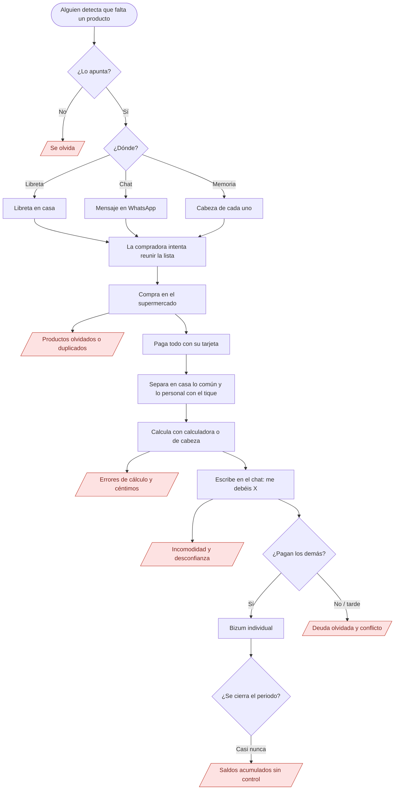
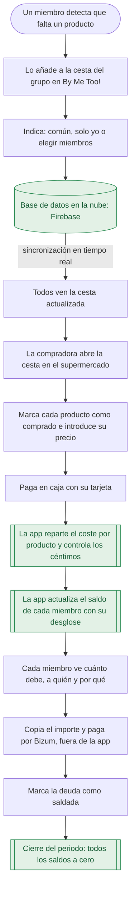
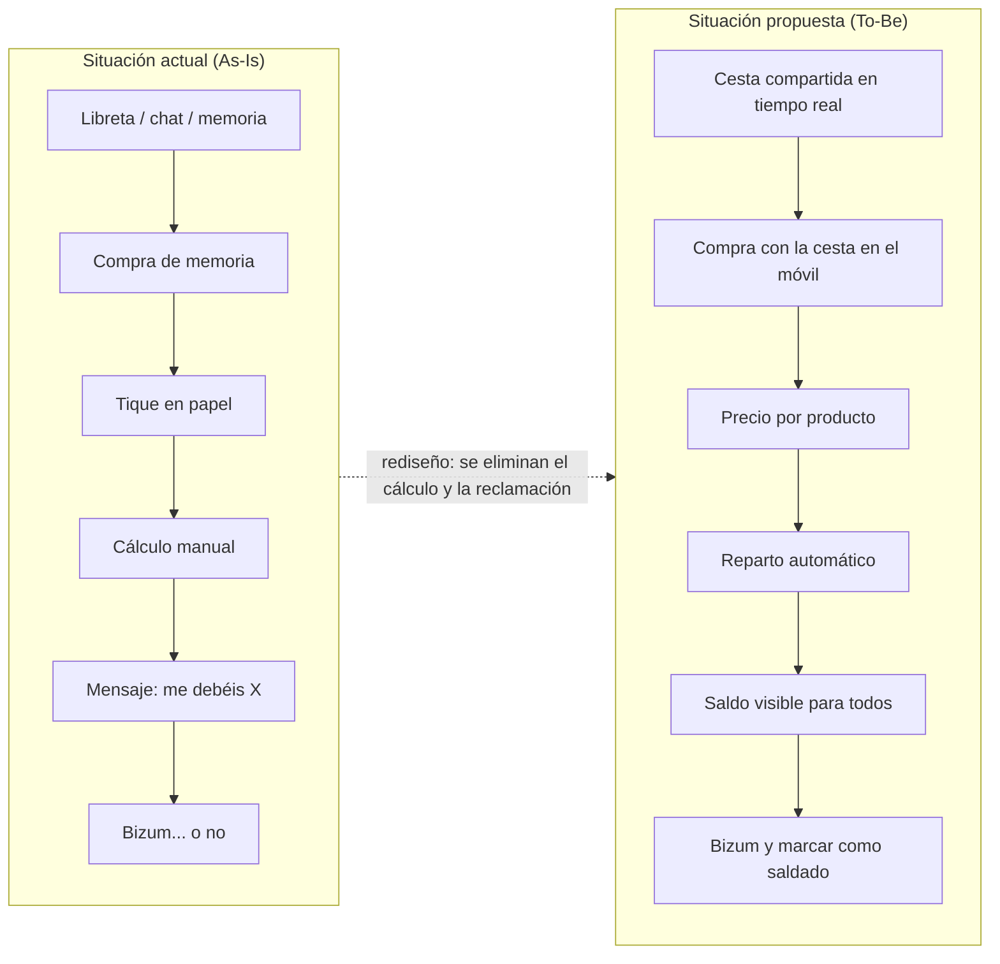

# 2.2. Análisis de la necesidad — *By Me Too!*

## 2.2.0. Marco teórico de referencia

Antes del diagnóstico se resumen las teorías que se usan para interpretar los datos. Cada una se vuelve a citar en el punto donde se aplica.

| Base teórica | Idea principal | Para qué se usa en este análisis |
| --- | --- | --- |
| **Análisis *As-Is / To-Be*** (situación actual / situación deseada) [2], [3] | Para mejorar un proceso primero hay que describir cómo se hace hoy (*As-Is*) y cómo debería hacerse (*To-Be*). Hammer advierte de que informatizar un proceso malo sin rediseñarlo solo lo hace más rápido, no mejor: *"don't automate, obliterate"* ("no automatices, elimina") [2] | Estructura de los apartados 2.2.1 (*As-Is*) y 2.2.3 (*To-Be*). Justifica que la app **elimine pasos** (calcular, reclamar), no que se limite a pasar la libreta al móvil |
| **Lista como memoria externa** [4] | La lista de la compra es una ayuda de memoria fuera de la cabeza; su utilidad depende de que esté completa y de que se lleve encima en el momento de comprar | Explica los olvidos (**[Encuesta]** 82,7 %) |
| **Teoría de la carga cognitiva** [5] | La memoria de trabajo (la que usamos para pensar "en el momento") es muy limitada; si una tarea exige retener y calcular varias cosas a la vez, aumentan los errores | Explica los errores al repartir de cabeza en el supermercado o con la calculadora |
| **Contabilidad mental** (*mental accounting*) [6] | Las personas no tratan el dinero como algo neutro: lo clasifican en "cuentas mentales" propias, con reglas subjetivas | Explica por qué cada compañero "recuerda" la deuda de forma distinta y aparecen discusiones |
| **Teoría de la equidad** [7] | Cuando una persona percibe que aporta más de lo que recibe (o paga lo que no consume), siente tensión y tiende a corregirlo: protesta, reduce su aportación o abandona la relación | Explica por qué repartir "a partes iguales" productos que no consumen todos genera conflicto |
| **Groupware y CSCW** [8] | *Groupware* es el software que ayuda a un grupo a trabajar sobre un objetivo común; CSCW (*Computer-Supported Cooperative Work*, "trabajo cooperativo asistido por ordenador") es la disciplina que lo estudia. Requiere un **contexto compartido**, **notificación** de los cambios de los demás y **control de concurrencia** (que dos ediciones simultáneas no se pisen) | Justifica la lista compartida en tiempo real |
| **Liquidación de deudas múltiples** [9] | Saldar las deudas de un grupo con pocas transferencias es un problema matemático estudiado: una versión tiene solución sencilla y otra (minimizar el número exacto de pagos) es NP-difícil, es decir, no se conoce forma rápida de resolverla en todos los casos | Justifica que el cálculo de "quién paga a quién" lo haga un algoritmo y no una persona |
| **Reparto proporcional con indivisibles** [10] | Repartir una cantidad entera (aquí, céntimos) entre varias partes produce restos que hay que asignar con una regla justa y conocida | Justifica el control de céntimos (KPI "precisión del reparto 100 %") |
| ***Jobs to be done*** ("trabajos por hacer") [11] y **lienzo de propuesta de valor** [12] | El usuario no "quiere una app": quiere completar un trabajo (por ejemplo, "cerrar las cuentas del piso sin discutir"). La propuesta de valor encaja las **frustraciones** (*pains*) y **beneficios esperados** (*gains*) del usuario con lo que ofrece el producto | Estructura del apartado 2.2.3 |
| **Ingeniería de requisitos** [13], [14] y **modelo de calidad ISO/IEC 25010** [15] | Una necesidad se traduce en requisitos **funcionales** (qué hace el sistema) y **no funcionales u operativos** (cómo de bien lo hace: rendimiento, seguridad, usabilidad…). ISO/IEC 25010 clasifica estas características de calidad | Listado de necesidades del apartado 2.2.3 |
| **Priorización MoSCoW** [16], [17] | Clasifica los requisitos en *Must* (debe tener), *Should* (debería), *Could* (podría) y *Won't* (no tendrá por ahora) para acotar el alcance | Prioridad de cada necesidad |

---

## 2.2.1. Diagnóstico de la situación de partida

### A. Nivel macro: un gasto grande, frecuente y cada vez más compartido

**La alimentación es uno de los mayores gastos del hogar.** Según la Encuesta de Presupuestos Familiares del INE (Instituto Nacional de Estadística), en 2025 el gasto medio por hogar fue de **35.101 €**, y el capítulo "Alimentos y bebidas no alcohólicas" alcanzó **5.626 € por hogar** (+4,4 % respecto a 2024), el **16,0 %** del presupuesto. Solo lo supera la vivienda y sus suministros (33,2 %) [1].

**Cada vez más personas sin vínculo familiar comparten ese gasto.** La oferta de habitaciones en piso compartido creció un 19 % en 2025 y el precio medio llegó a 425 €/mes [18]. En un piso de cuatro personas, la compra de comida es, después del alquiler, el gasto común más grande y el **más frecuente**: no se paga una vez al mes como el alquiler, sino cada semana (**[Encuesta]** 66,7 %).

**Pagar ya no es el problema.** Bizum tuvo en 2025 **30,6 millones de usuarios** y 1.237 millones de operaciones [19], y el 74,7 % de la población usa la banca por Internet [20]. Transferir 12,23 € a un compañero cuesta segundos. El problema está **antes del pago**: saber *cuánto* debe cada uno y *atreverse a pedirlo*.

**Hablar de dinero incomoda.** El estudio "De dinero no se habla" de ING (N = 1.026, agosto de 2023) [21] aporta datos de la población española:

| Dato | Valor | Lectura para el proyecto |
| --- | --- | --- |
| Personas a las que les gusta hablar de dinero | 42 % (menos de la mitad) | El dinero es un tema delicado incluso entre amigos |
| Situación más incómoda: pedir a un amigo que **devuelva** dinero que se le dejó | **63 %** (frente al 37 % que elige "pedir prestado") | Reclamar es la parte más difícil. Es justo lo que le pasa a Lucía cuando adelanta la compra |
| Préstamos a amigos o familia que salieron mal ("no me lo devolvieron") | 20 %; otro 30 % se devolvió tarde o en parte | Las deudas informales se pierden u olvidan |
| Personas que reconocen que un amigo les debe dinero | 16 % | Las deudas pequeñas pendientes son habituales |
| Forma preferida de pagar en una quedada | 38 % "a escote" (repartir el total), 35 % "cada uno lo suyo" | Conviven dos modelos de reparto. Una app debe permitir **ambos** en la misma compra |

**Conclusión macro.** Hay un gasto grande (16 % del presupuesto), recurrente (semanal) y compartido por grupos sin jerarquía. El pago está resuelto; **el cálculo y la conversación sobre la deuda no**.

### B. Nivel meso: las herramientas que se usan hoy

*Meso: nivel intermedio entre la sociedad y la persona; aquí, las herramientas y los servicios del mercado.*

Según la **[Encuesta]**, la compra compartida se organiza hoy con:

| Herramienta | Uso | Para qué sirve | Qué no hace |
| --- | --- | --- | --- |
| Libreta o papel compartido (por ejemplo, en la nevera) | 48,5 % | Apuntar lo que falta | No se lleva al supermercado si no la lleva quien compra; no avisa; no calcula |
| Chat de grupo (WhatsApp) | 24,2 % | Pedir productos y avisar de la deuda | Los mensajes se mezclan con otros temas; no hay estado "pendiente / comprado"; no calcula |
| Ninguna (de memoria) | 21,3 % | — | Todo depende de la memoria de quien compra |
| Calculadora del móvil u hoja de cálculo | Uso puntual (observación del equipo, Memoria 1.3.1) | Repartir el tique | Manual, sin historial compartido, propensa a errores |
| Apps de reparto (Splitwise, Tricount) | Minoritario en el público objetivo | Registrar gastos y saldos | No gestionan la lista; en Splitwise, el desglose por producto del tique está ligado a funciones de pago (Pro) [22]; Tricount reparte por gasto [23] |
| Apps de listas (Bring!, Listonic, Google Keep) | Minoritario | Lista compartida | No reparten gastos |

**Diagnóstico meso.** El proceso está **fragmentado**: la información de *qué comprar* vive en un medio (libreta o chat), la de *cuánto costó* en el tique de papel, la de *cuánto debe cada uno* en la cabeza o la calculadora de quien compró, y el *pago* en Bizum. Ninguna herramienta conecta los cuatro.

### C. Nivel micro: cómo se hace hoy una compra compartida (*As-Is*)

El equipo ha reconstruido el proceso actual mediante **observación** de situaciones cotidianas y la **encuesta** (Memoria 1.3.1). Se describe con el caso típico de la Ficha 1: Lucía, que comparte piso con tres personas.

| Fase | Qué ocurre | Quién | Herramienta | Problema que aparece |
| --- | --- | --- | --- | --- |
| 1. Detectar la necesidad | Alguien ve que falta leche o detergente | Cualquiera | Memoria / libreta | Se apunta o no, según la persona |
| 2. Anotar | Se escribe en la libreta o se manda un mensaje al chat | Cualquiera | Libreta, chat | Lista repartida en dos sitios; duplicados |
| 3. Preparar la compra | Lucía intenta reunir lo apuntado antes de salir | Compradora | Foto de la libreta, *scroll* en el chat | Información incompleta o desactualizada |
| 4. Comprar | En el supermercado, de pie, con el carro | Compradora | Memoria | Olvidos (**[Encuesta]** 82,7 %); llamadas o mensajes de última hora |
| 5. Pagar | Lucía adelanta todo el importe | Compradora | Tarjeta | Lucía asume el riesgo de no recuperar el dinero |
| 6. Repartir | En casa, con el tique, separa lo común de lo personal y calcula | Compradora | Calculadora, de cabeza | Errores, céntimos, tiempo; nadie más puede comprobarlo |
| 7. Comunicar la deuda | Escribe "me debéis X" en el chat | Compradora | Chat | Incomodidad social; desconfianza ("¿por qué tanto?") |
| 8. Cobrar | Cada uno hace un Bizum… o se olvida | Resto del grupo | Bizum | Deudas olvidadas; recordatorios que tensan la relación |
| 9. Cerrar el periodo | Rara vez se hace: las deudas se compensan "a ojo" | Nadie | — | Saldos acumulados sin control |

**Ejemplo numérico.** Lucía compra para el piso por **47,85 €**:

- Productos comunes (para los cuatro): 38,40 € → 9,60 € por persona.
- Champú solo para Lucía: 4,20 €.
- Cervezas solo para Lucía y Andrés: 5,25 € → 2,625 € por persona, un importe que **no existe en céntimos**: alguien paga 2,63 € y otro 2,62 €.

| Persona | Comunes | Personales | Compartidos parcialmente | Total |
| --- | --- | --- | --- | --- |
| Lucía | 9,60 € | 4,20 € | 2,62 € | 16,42 € |
| Andrés | 9,60 € | — | 2,63 € | 12,23 € |
| Compañero 3 | 9,60 € | — | — | 9,60 € |
| Compañero 4 | 9,60 € | — | — | 9,60 € |
| **Suma** | | | | **47,85 €** ✓ |

Lucía debe recibir 31,43 €. Para llegar a esta tabla hay que retener 3 categorías de productos, 4 personas y un redondeo, justo lo que la teoría de la carga cognitiva señala como fuente de errores [5]. Con una compra real de 20–30 productos y varias compras por semana, el cálculo manual deja de ser razonable. Si se reparte "a partes iguales" para ahorrarse el cálculo (11,96 € cada uno), los compañeros 3 y 4 pagan 2,36 € por productos que no consumen: es la inequidad que describe Adams [7].

### Diagrama 1. Flujo actual (*As-Is*)

*En rojo, los puntos donde se pierde información, tiempo o dinero.*

---

## 2.2.2. Problemas y consecuencias identificadas

### A. Los tres cuellos de botella

Un **cuello de botella** es el punto de un proceso que frena todo lo demás. En el flujo actual hay tres:

1. **Información dispersa (fases 1–4).** La lista está repartida entre libreta, chat y memoria. Mientras no esté en un único sitio, accesible desde el supermercado y actualizada al momento, los olvidos son inevitables [4], [8].
2. **Cálculo manual (fase 6).** Todo el reparto depende de una sola persona, que además es la acreedora (a quien le deben el dinero). Es lento, tiene errores y nadie más puede comprobarlo [5], [9], [10].
3. **Reclamación social (fases 7–8).** Pedir que te devuelvan el dinero es la situación más incómoda para el 63 % de la población [21]. Si el importe no está justificado, se convierte en discusión [6], [7].

### B. Listado de problemas

| ID | Problema | Evidencia | Base teórica | Consecuencia |
| --- | --- | --- | --- | --- |
| **P1** | **Productos olvidados** porque la lista no está completa ni se lleva encima | **[Encuesta]** 82,7 % | Memoria externa [4] | Segundo viaje a la tienda, compras de última hora más caras, tiempo perdido |
| **P2** | **Lista dispersa y desactualizada** en varios medios | **[Encuesta]** 48,5 % libreta, 24,2 % chat, 21,3 % ninguna | Contexto compartido en groupware [8] | Duplicados (dos personas compran lo mismo), mensajes perdidos, sin estado "pendiente / comprado" |
| **P3** | **No se sabe quién pidió cada producto** ni si es común o personal | Observación del equipo (Memoria 1.2.5) | Equidad [7] | Imposible repartir de forma justa después |
| **P4** | **Cálculo manual del reparto** propenso a errores, sobre todo con productos parciales y céntimos | Ejemplo numérico de 2.2.1 C | Carga cognitiva [5]; reparto de indivisibles [10] | Importes incorrectos; tiempo de la compradora; los céntimos "desaparecen" o los paga siempre la misma persona |
| **P5** | **Reparto injusto "a partes iguales"** para evitar el cálculo | 38 % prefiere pagar "a escote" y 35 % "cada uno lo suyo" [21]: el grupo no comparte un único criterio | Equidad [7] | Quien no consume ciertos productos paga por ellos; tensión y abandono de la cuenta común |
| **P6** | **Falta de transparencia**: solo la compradora conoce el detalle del tique | Observación del equipo | Contabilidad mental [6] | Desconfianza ("¿por qué te debo tanto?"); Andrés: "Dime cuánto es", pero también "por qué" (Ficha 2) |
| **P7** | **Incomodidad al reclamar** el dinero | 63 % considera más incómodo pedir que te devuelvan que pedir prestado [21] | Contabilidad mental [6] | Lucía prefiere perder dinero antes que reclamar; se acumula malestar |
| **P8** | **Deudas olvidadas o pagadas tarde** | 20 % de los préstamos a amigos no se devuelven y un 30 % se devuelve tarde o en parte [21]; 16 % tiene un amigo que le debe dinero [21] | Liquidación de deudas [9] | Pérdida económica para quien adelanta; conflictos |
| **P9** | **Sin cierre de periodo**: las deudas se compensan "a ojo" | Observación del equipo | Liquidación de deudas [9] | Saldos sin control durante meses; nadie sabe el estado real |
| **P10** | **Herramientas desconectadas**: lista, tique, cálculo y pago en sitios distintos | Análisis de mercado (2.2.1 B; Memoria 1.1.4) | *As-Is / To-Be* [2] | Cada paso exige copiar información a mano de un medio a otro |

### C. Consecuencias agrupadas

| Tipo | Consecuencias | Problemas |
| --- | --- | --- |
| **Económicas** | Dinero no recuperado, segundos viajes, pagar productos que no se consumen | P1, P5, P8 |
| **De tiempo** | Reunir la lista, calcular el tique, enviar recordatorios | P2, P4, P10 |
| **Sociales** | Discusiones, desconfianza, malestar, salida del piso o del grupo | P5, P6, P7, P9 |
| **De información** | Nadie tiene una visión completa y fiable del estado del grupo | P2, P3, P6, P9 |

### D. Por qué las soluciones actuales no bastan

- **Digitalizar solo la lista** (Bring!, Keep) resuelve P1–P2, pero no P3–P9.
- **Digitalizar solo el gasto** (Splitwise, Tricount) resuelve parte de P7–P9, pero exige introducir el tique **otra vez**, a mano, después de comprar (P10), y el desglose por producto no es su caso de uso principal [22], [23].
- **Usar las dos** obliga a copiar datos de una app a otra: es "automatizar" sin rediseñar, justo lo que Hammer desaconseja [2].

> **Carencia detectada.** No existe una herramienta que conecte en un mismo flujo **la lista compartida, el registro de lo comprado por producto, el reparto justo (común, personal y parcial) y el saldo de cada miembro**. Esa carencia es la que justifica desarrollar *By Me Too!*.

> **Limitación del diagnóstico.** La encuesta del equipo midió sobre todo la **organización de la lista** (P1–P2). Los datos sobre dinero (P5, P7, P8) proceden de un estudio general de la población española [21], no específico de pisos compartidos. Se propone añadir preguntas sobre el reparto a la encuesta del grupo piloto (Memoria, OE-X5) para confirmarlos en nuestro público.

---

## 2.2.3. Propuesta de valor y situación deseada

### A. El trabajo que el usuario quiere completar

Desde el enfoque *Jobs to be done* [11], el trabajo principal de los tres perfiles no es "usar una app", sino:

> **"Comprar lo que necesita el grupo sin olvidos y que cada uno pague exactamente lo que le corresponde, sin tener que calcularlo ni reclamarlo."**

| Perfil | Trabajo concreto |
| --- | --- |
| Lucía (organizadora) | "Llevar la lista completa y recuperar lo que adelanto sin pedirlo yo." |
| Andrés (participante) | "Saber cuánto debo, por qué, y pagarlo en un minuto." |
| Marta (evento) | "Repartir solo entre quien consume y cerrar las cuentas el mismo día." |

### B. Lienzo de propuesta de valor

El lienzo de propuesta de valor [12] relaciona lo que el usuario sufre (*pains*) y desea (*gains*) con lo que ofrece el producto.

| Lado del usuario | | Lado del producto | |
| --- | --- | --- | --- |
| **Frustraciones (*pains*)** | **Beneficios esperados (*gains*)** | **Aliviadores de frustración** | **Creadores de beneficio** |
| Olvidar productos (P1) | Lista siempre completa en el móvil | Lista única sincronizada en tiempo real | Marcar "comprado" con un toque en el supermercado |
| Duplicados y mensajes perdidos (P2) | Saber qué falta de un vistazo | Estado "pendiente / comprado" visible para todos | Aviso al resto del grupo cuando se completa la compra |
| Calcular el tique (P4) | Reparto automático y exacto | Algoritmo común / personal / parcial con control de céntimos | Registro de una compra de 5 productos en ≤ 60 s (KPI) |
| Pagar lo que no consumo (P5) | Reparto justo | Cada producto se asigna a quien lo consume | Chips "Común / Solo yo / Elegir…" |
| Desconfianza (P6) | Entender por qué debo | Historial visible: quién compró qué, cuándo y entre quién se reparte | Desglose por producto con divulgación progresiva (2.1.3) |
| Incomodidad al reclamar (P7) | Que "lo diga la app", no yo | El saldo lo calcula y muestra el sistema, no una persona | Botón "Copiar importe" para pagar por Bizum |
| Deudas olvidadas (P8, P9) | Cuentas a cero periódicamente | Balance y liquidación por periodos | Propuesta de "quién paga a quién" con el mínimo de transferencias razonable [9] |

**Propuesta de valor en una frase.** *By Me Too!* es la única app que convierte **la misma lista de la compra** del grupo en **el reparto justo de su coste**, de forma que nadie tenga que calcular ni reclamar.

### C. Situación deseada (*To-Be*)

Siguiendo a Hammer [2], el nuevo proceso **no copia** el actual en el móvil, sino que **elimina fases**: el reparto (fase 6) y la reclamación (fase 7) dejan de ser tareas de una persona y pasan a ser un resultado automático del sistema.

| Fase *As-Is* | Fase *To-Be* | Cambio |
| --- | --- | --- |
| 1–3. Detectar, anotar, reunir la lista | Cualquiera añade el producto a la cesta del grupo desde su móvil, indicando si es común, personal o para varios | **Unificada**: una sola lista, con autor y destinatarios desde el principio |
| 4. Comprar de memoria | La compradora abre la cesta en el supermercado y marca lo que coge | **Mejorada**: la lista va en el bolsillo y se actualiza en tiempo real |
| 5. Pagar | Paga y registra el importe de cada producto | **Igual** (pago con tarjeta), más el registro |
| 6. Repartir a mano | La app reparte al céntimo según la asignación de cada producto | **Eliminada** como tarea humana |
| 7. Comunicar la deuda | Cada miembro ve su saldo y su desglose | **Eliminada** como tarea humana |
| 8. Cobrar | Cada uno paga por Bizum, fuera de la app, y lo marca como saldado | **Simplificada** |
| 9. Cerrar el periodo | La app propone el cierre (semanal, quincenal, mensual o personalizado) | **Nueva** |

### Diagrama 2. Flujo propuesto (*To-Be*)

*En verde, las tareas que antes hacía una persona y ahora hace el sistema.*

### Diagrama 3. Comparación conceptual de los dos flujos

### D. Indicadores de la mejora

La mejora se medirá con los KPI ya definidos en la Memoria (1.4.3):

| Problema | Situación actual | Situación deseada (KPI) |
| --- | --- | --- |
| P1 Olvidos | 82,7 % olvida productos **[Encuesta]** | Reducción medida en la encuesta al grupo piloto (OE-X5) |
| P2 Lista desactualizada | Cambios comunicados por chat, sin estado | Cambios visibles en otro dispositivo en ≤ 2 s (OE-D3) |
| P4 Cálculo manual | Minutos por tique, con errores | Precisión del reparto 100 %; registro de 5 productos en ≤ 60 s |
| P8–P9 Deudas sin cerrar | Sin control | ≥ 70 % de periodos cerrados con saldos a cero |
| Adopción | — | Activación ≥ 60 %; retención a 30 días ≥ 40 % |

### E. Listado justificado de necesidades de alto nivel

Las necesidades se clasifican, según la ingeniería de requisitos [13], [14], en:

- **Funcionales (NF):** *qué* debe hacer el software.
- **Operativas (NO):** *cómo de bien* debe hacerlo y en qué condiciones de uso (requisitos no funcionales, clasificados con las características de ISO/IEC 25010 [15]).

Son necesidades **de alto nivel**: se detallarán como requisitos concretos e historias de usuario en el Capítulo III.

#### Necesidades funcionales

| ID | Necesidad | Prioridad | Justificación (problema y fuente) | Objetivo |
| --- | --- | --- | --- | --- |
| **NF-01** | Registro, inicio de sesión y perfil mínimo | Must | Identificar a cada miembro es la base para asignar productos y deudas (P3). Datos mínimos (RGPD art. 5.1.c) [24] | OE-D2 |
| **NF-02** | Crear grupos e invitar mediante enlace compartible (por ejemplo, por WhatsApp) | Must | Los grupos ya se coordinan por chat (**[Encuesta]** 24,2 %); Marta necesita invitar en segundos (Ficha 3) | OE-D2 |
| **NF-03** | Cestas compartidas: crear, editar y eliminar productos, con autor visible | Must | P1, P2, P3. Contexto compartido [8] | OE-D3 |
| **NF-04** | Sincronización en tiempo real de la cesta entre todos los miembros | Must | P2. Notificación y control de concurrencia en groupware [8]; [25] | OE-D3 |
| **NF-05** | Estado de cada producto: pendiente / comprado, marcable con un toque | Must | P1, P2. Uso con una mano en el supermercado (2.1.3) | OE-D3 |
| **NF-06** | Asignar cada producto como común, personal o parcial (miembros elegidos) | Must | P3, P5. Teoría de la equidad [7]; conviven "a escote" y "cada uno lo suyo" [21] | OE-D5 |
| **NF-07** | Registrar la compra: comprador, precio por producto y fecha | Must | P4, P10. Elimina la segunda introducción de datos | OE-D4 |
| **NF-08** | Algoritmo de reparto con control de céntimos (la suma de las partes coincide siempre con el total) | Must | P4. Reparto de indivisibles [10]; carga cognitiva [5] | OE-D5 |
| **NF-09** | Saldo por miembro con desglose por producto e historial | Must | P6, P7. Transparencia frente a la contabilidad mental [6] | OE-D6 |
| **NF-10** | Propuesta de liquidación "quién paga a quién" con pocas transferencias | Should | P8. Liquidación de deudas múltiples [9] | OE-D6 |
| **NF-11** | Marcar una deuda como saldada (pago hecho fuera de la app) y botón "Copiar importe" | Should | P7, P8. Bizum ya normalizado [19] | OE-D6 |
| **NF-12** | Cierre de periodos (semanal, quincenal, mensual o personalizado) | Should | P9 | OE-D6 |
| **NF-13** | Notificaciones de eventos clave (compra registrada, nuevo saldo, periodo cerrado) | Should | P2, P8. Notificación en groupware [8] | OE-D3 |
| **NF-14** | Exportar mis datos y el historial del grupo (JSON / CSV) y darme de baja con anonimización | Should | Derechos ARSOPL [26], [24] | OE-D7 |
| **NF-15** | Plan premium: más grupos y sin anuncios, cobrado mediante las tiendas | Could | Modelo freemium (2.1.2); pago delegado [27], [28] | — |
| **NF-16** | Sugerencias de productos frecuentes y "repetir la última compra" | Could | Compra semanal (**[Encuesta]** 66,7 %) | — |
| **NF-17** | Pagos entre miembros dentro de la app | Won't | Evita la regulación de servicios de pago [29], [30]; Bizum ya lo resuelve [19] (Memoria 1.6.1) | — |
| **NF-18** | Escaneo de tiques por OCR | Won't (v1.0) | Versión futura y ventaja premium (Memoria 1.6.1) | — |

#### Necesidades operativas

| ID | Necesidad | Característica ISO/IEC 25010 [15] | Prioridad | Justificación |
| --- | --- | --- | --- | --- |
| **NO-01** | **Exactitud del cálculo**: 0 errores en los casos de prueba del reparto; la suma de las partes igual al total, al céntimo | Adecuación funcional (corrección) | Must | P4; criticidad del dato en FinTech [3]; KPI 100 % |
| **NO-02** | **Integridad**: cada compra se guarda completa o no se guarda (operación atómica) | Fiabilidad | Must | Un saldo a medias rompe la confianza (P6) [3] |
| **NO-03** | **Tiempo de respuesta**: cambios visibles en otro dispositivo en ≤ 2 s | Eficiencia de desempeño | Must | P2; OE-D3 [25] |
| **NO-04** | **Uso sin conexión**: consultar y marcar productos sin cobertura y sincronizar después | Fiabilidad (disponibilidad, tolerancia a fallos) | Should | Uso en el interior de supermercados, donde la cobertura puede fallar [31] |
| **NO-05** | **Usabilidad**: registrar 5 productos con su reparto en ≤ 60 s; uso con una mano; puntuación SUS ≥ 70 (SUS, *System Usability Scale*: cuestionario estándar de usabilidad) | Capacidad de interacción | Must | Fichas 1–3; OE-T4 |
| **NO-06** | **Accesibilidad**: WCAG 2.2 nivel AA (contraste, tamaño de zonas táctiles, lectores de pantalla, texto escalable) | Capacidad de interacción (inclusividad) | Should | [32], [33]; apartado 2.1.3 |
| **NO-07** | **Seguridad y privacidad**: autenticación gestionada por Firebase (la app no guarda contraseñas), comunicación cifrada con TLS, reglas de acceso por grupo, sin datos de tarjeta | Seguridad | Must | RGPD art. 25 [24], [34]; marco legal [26] |
| **NO-08** | **Multiplataforma**: mismo comportamiento en Android e iOS con un solo código (Flutter) y cliente de escritorio en Java Swing | Flexibilidad (adaptabilidad) | Must | Grupos que mezclan Android e iOS (2.1.1) [35] |
| **NO-09** | **Mantenibilidad**: patrón MVC (Modelo-Vista-Controlador, que separa datos, interfaz y lógica), integración por Pull Request y lógica de reparto con pruebas unitarias (cobertura ≥ 80 %) | Mantenibilidad (modularidad, capacidad de prueba) | Must | OE-D8, OE-T2 |
| **NO-10** | **Coste de operación nulo en la fase piloto**: uso del plan gratuito de Firebase | — (restricción de proyecto) | Must | Sin financiación (Memoria 1.6, Tabla 11) |
| **NO-11** | **Idioma y moneda**: español y euros, con formato 0,00 € | Adecuación funcional | Must | Ámbito inicial España (Memoria 1.5) |

#### Trazabilidad problema → necesidad

| Problema | Necesidades que lo resuelven |
| --- | --- |
| P1 Olvidos | NF-03, NF-05, NO-04 |
| P2 Lista dispersa | NF-03, NF-04, NF-13, NO-03 |
| P3 Autor y destinatario desconocidos | NF-01, NF-03, NF-06 |
| P4 Cálculo manual | NF-07, NF-08, NO-01 |
| P5 Reparto injusto | NF-06, NF-08 |
| P6 Falta de transparencia | NF-09, NO-02 |
| P7 Incomodidad al reclamar | NF-09, NF-11 |
| P8 Deudas olvidadas | NF-10, NF-11, NF-13 |
| P9 Sin cierre de periodo | NF-12 |
| P10 Herramientas desconectadas | NF-03 a NF-09 (flujo único) |

---

## Conclusión

En España, la alimentación supone el 16 % del gasto del hogar [1] y cada vez más personas sin vínculo familiar la comparten [18]. El pago entre particulares está resuelto [19], pero **el proceso que lleva hasta él no lo está**: la lista está dispersa, el reparto se calcula a mano y reclamar el dinero es incómodo para la mayoría [21]. La teoría explica por qué: la memoria y el cálculo sin apoyo fallan [4], [5], el dinero entre iguales se vive de forma subjetiva [6] y el reparto injusto genera conflicto [7]. *By Me Too!* no se limita a digitalizar la libreta: rediseña el proceso [2] para que **la misma lista del grupo produzca el reparto justo y el saldo de cada miembro**, eliminando las dos tareas que hoy recaen en una sola persona: calcular y reclamar.

---

## Referencias

[1] Instituto Nacional de Estadística (INE), "Encuesta de Presupuestos Familiares (EPF). Año 2025. Resultados definitivos", nota de prensa, 25 jun. 2026. [En línea]. Disponible en: https://ine.es/dyngs/Prensa/EPF2025.pdf

[2] M. Hammer, "Reengineering work: Don't automate, obliterate", *Harvard Business Review*, vol. 68, n.º 4, pp. 104–112, jul.–ago. 1990.

[3] W. Acosta Lugo, "Financial Technology (tecnología financiera): FinTech. Orientado al desarrollo del Capítulo II del Proyecto de Desarrollo de Aplicaciones Multiplataforma", material docente, Sprint 02, Centro FP Superior Campus Cámara de Comercio Sevilla, 2026.

[4] L. G. Block y V. G. Morwitz, "Shopping lists as an external memory aid for grocery shopping: Influences on list writing and list fulfillment", *Journal of Consumer Psychology*, vol. 8, n.º 4, pp. 343–376, 1999.

[5] J. Sweller, "Cognitive load during problem solving: Effects on learning", *Cognitive Science*, vol. 12, n.º 2, pp. 257–285, 1988.

[6] R. H. Thaler, "Mental accounting matters", *Journal of Behavioral Decision Making*, vol. 12, n.º 3, pp. 183–206, 1999.

[7] J. S. Adams, "Inequity in social exchange", en *Advances in Experimental Social Psychology*, vol. 2, L. Berkowitz, Ed. Nueva York, NY, EE. UU.: Academic Press, 1965, pp. 267–299.

[8] C. A. Ellis, S. J. Gibbs y G. Rein, "Groupware: Some issues and experiences", *Communications of the ACM*, vol. 34, n.º 1, pp. 39–58, 1991.

[9] T. Verhoeff, "Settling multiple debts efficiently: An invitation to computing science", *Informatics in Education*, vol. 3, n.º 1, pp. 105–126, 2004.

[10] M. L. Balinski y H. P. Young, *Fair Representation: Meeting the Ideal of One Man, One Vote*. New Haven, CT, EE. UU.: Yale University Press, 1982.

[11] C. M. Christensen, T. Hall, K. Dillon y D. S. Duncan, "Know your customers' 'jobs to be done'", *Harvard Business Review*, vol. 94, n.º 9, pp. 54–62, sep. 2016.

[12] A. Osterwalder, Y. Pigneur, G. Bernarda y A. Smith, *Value Proposition Design: How to Create Products and Services Customers Want*. Hoboken, NJ, EE. UU.: Wiley, 2014.

[13] I. Sommerville, *Software Engineering*, 10.ª ed. Boston, MA, EE. UU.: Pearson, 2016.

[14] *Systems and software engineering — Life cycle processes — Requirements engineering*, ISO/IEC/IEEE 29148:2018, 2018.

[15] *Systems and software engineering — Systems and software Quality Requirements and Evaluation (SQuaRE) — Product quality model*, ISO/IEC 25010:2023, 2023.

[16] W. Acosta Lugo, "Análisis de riesgos: Spikes y MoSCoW", material docente, Sprint 02, Centro FP Superior Campus Cámara de Comercio Sevilla, 2026.

[17] DSDM Consortium, *The DSDM Agile Project Framework Handbook*. Farnham, Reino Unido: Agile Business Consortium, 2014. [En línea]. Disponible en: https://www.agilebusiness.org/page/ProjectFrameworkHandbook

[18] idealista, "La oferta de habitaciones crece un 19%, mientras el precio aumenta un 4% en 2025", 16 ene. 2026. [En línea]. Disponible en: https://www.idealista.com/news/inmobiliario/vivienda/2026/01/16/879857-la-oferta-de-habitaciones-crece-un-19-mientras-el-precio-aumenta-un-4-en-2025

[19] EFE / Infobae, "El volumen de operaciones con Bizum creció un 53 % en 2025 y se situó en 67.751 millones", 19 ene. 2026. [En línea]. Disponible en: https://www.infobae.com/espana/agencias/2026/01/19/el-volumen-de-operaciones-con-bizum-crecio-un-53-en-2025-y-se-situo-en-67751-millones/

[20] Instituto Nacional de Estadística (INE), "Encuesta sobre Equipamiento y Uso de Tecnologías de Información y Comunicación en los Hogares (TIC-H). Año 2025", nota de prensa, 20 nov. 2025. [En línea]. Disponible en: https://www.ine.es/dyngs/Prensa/TICH2025.htm

[21] ING España, "De dinero no se habla. Resultados investigación cuantitativa", encuesta en línea (N = 1.026), trabajo de campo del 8 al 14 ago. 2023. [En línea]. Disponible en: https://ing.es/sobre-ing/pdf/estudiodedineronosehabla.pdf

[22] Splitwise Help Center, "What is Splitwise Pro?". [En línea]. Disponible en: https://kb.splitwise.com/pro/what-is-splitwise-pro

[23] Tricount, sitio oficial. [En línea]. Disponible en: https://www.tricount.com/

[24] Parlamento Europeo y Consejo de la Unión Europea, "Reglamento (UE) 2016/679 relativo a la protección de las personas físicas en lo que respecta al tratamiento de datos personales y a la libre circulación de estos datos (Reglamento General de Protección de Datos)", *Diario Oficial de la Unión Europea*, L 119, 4 may. 2016. [En línea]. Disponible en: https://eur-lex.europa.eu/legal-content/ES/TXT/?uri=CELEX:32016R0679

[25] Google, "Get realtime updates with Cloud Firestore", documentación de Firebase. [En línea]. Disponible en: https://firebase.google.com/docs/firestore/query-data/listen

[26] W. Acosta Lugo, "Marco de seguridad, legalidad y accesibilidad riguroso: puntos álgidos", material docente, Sprint 02, Centro FP Superior Campus Cámara de Comercio Sevilla, 2026.

[27] Google, "Payments policy", Centro de políticas para desarrolladores de Google Play. [En línea]. Disponible en: https://support.google.com/googleplay/android-developer/answer/9858738

[28] Apple, "App Review Guidelines", apartado 3.1.1 "In-App Purchase". [En línea]. Disponible en: https://developer.apple.com/app-store/review/guidelines/

[29] Parlamento Europeo y Consejo de la Unión Europea, "Directiva (UE) 2015/2366 sobre servicios de pago en el mercado interior (PSD2)", *Diario Oficial de la Unión Europea*, L 337, 23 dic. 2015. [En línea]. Disponible en: https://eur-lex.europa.eu/legal-content/ES/TXT/?uri=CELEX:32015L2366

[30] España, "Real Decreto-ley 19/2018, de 23 de noviembre, de servicios de pago y otras medidas urgentes en materia financiera", *Boletín Oficial del Estado*, n.º 284, 24 nov. 2018. [En línea]. Disponible en: https://www.boe.es/eli/es/rdl/2018/11/23/19

[31] Google, "Access data offline", documentación de Firebase. [En línea]. Disponible en: https://firebase.google.com/docs/firestore/manage-data/enable-offline

[32] World Wide Web Consortium (W3C), *Web Content Accessibility Guidelines (WCAG) 2.2*, W3C Recommendation, 2023. [En línea]. Disponible en: https://www.w3.org/TR/WCAG22/

[33] Asociación Española de Normalización (UNE), *Requisitos de accesibilidad para productos y servicios TIC*, UNE-EN 301 549:2022, 2022. [En línea]. Disponible en: https://www.en-301-549.info/

[34] Agencia Española de Protección de Datos (AEPD), *Guía de Privacidad desde el Diseño*. Madrid, España, 2019. [En línea]. Disponible en: https://www.aepd.es/guias/guia-privacidad-desde-el-diseno.pdf

[35] Google, "Flutter documentation". [En línea]. Disponible en: https://docs.flutter.dev/

Fuente interna: encuesta del equipo *By Me Too!* (N = 75), Memoria del proyecto, apartado 1.1.3; observación de situaciones cotidianas, Memoria, apartado 1.3.1.
